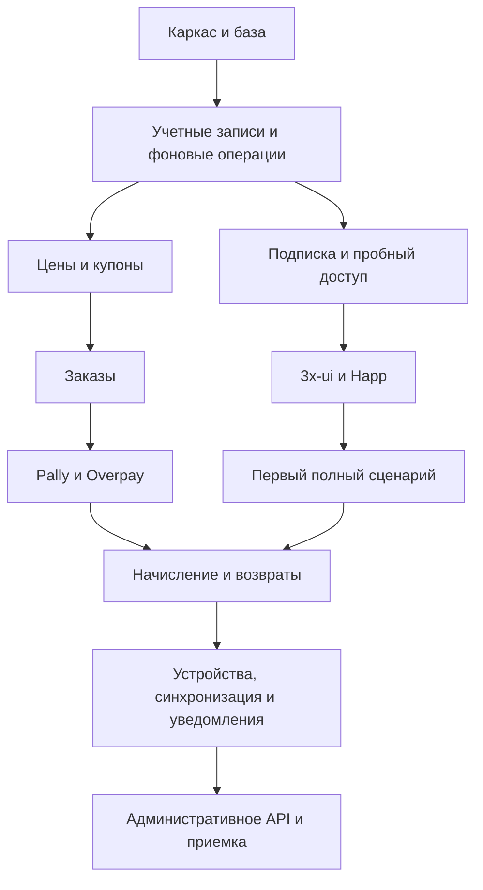

# Подробный технический план реализации бэкенда OpenViya

Дата подготовки: 14 октября 2026 года. Статус: план реализации; перечисленные файлы, таблицы и API предстоит создать.

Основание: [согласованные требования Q1–Q55](requirements.md), [архитектура](architecture.md), [ADR-0001](adr/0001-modular-monolith.md) и [словарь предметной области](../../CONTEXT.md).

Документ описывает последовательность работ, границы модулей, проектируемую модель данных, контракты API, обработку сбоев и критерии готовности. Бизнес-правила взяты из согласованных требований. Названия классов, таблиц, состояний, маршрутов и технические настройки ниже — предложения для реализации, а не утверждение, что соответствующий код уже существует. Изменения бизнес-правил должны отдельно отражаться в требованиях.

## Содержание

1. [Границы первой версии и порядок работ](#scope)
2. [Модули и зависимости](#modules)
3. [Общие технические правила](#rules)
4. [Модель данных и состояния](#data)
5. [Этап 0. Фиксация инструментов и контрактов](#stage-0)
6. [Этап 1. Запускаемый каркас](#stage-1)
7. [Этап 2. PostgreSQL, миграции и фоновые операции](#stage-2)
8. [Этап 3. Учетные записи, авторизация, роли и аудит](#stage-3)
9. [Этап 4. Подписка и пробный доступ](#stage-4)
10. [Этап 5. 3x-ui, Happ и первый полный сценарий](#stage-5)
11. [Этап 6. Предложения, цены, скидки и купоны](#stage-6)
12. [Этап 7. Оформление покупки и заказы](#stage-7)
13. [Этап 8. Pally для СБП](#stage-8)
14. [Этап 9. Overpay для карт](#stage-9)
15. [Этап 10. Подтверждение оплаты и начисление времени](#stage-10)
16. [Этап 11. Полные и частичные возвраты](#stage-11)
17. [Этап 12. Устройства и синхронизация нод](#stage-12)
18. [Этап 13. Уведомления и напоминания](#stage-13)
19. [Этап 14. API административного кабинета](#stage-14)
20. [Этап 15. Контейнеры, наблюдаемость и приемка](#stage-15)
21. [Матрица обязательных проверок](#tests)
22. [Параметры реальных подключений и точки уточнения](#connection)
23. [Первичные источники](#sources)

<a id="scope"></a>

## 1. Границы первой версии и порядок работ

Реализуется одно приложение на Java 25 LTS и Spring Boot 4.1.1 с Maven Wrapper, PostgreSQL, миграциями, REST API и Docker Compose. Бэкенд управляет коммерческими правилами и связывает клиентские каналы с внешними системами.

В первую версию входят:

- Пользователи через Telegram и отдельные сотрудники с логином, паролем и 2FA.
- Подписка на одного пользователя; периоды 7/30/90/180/365 суток.
- Пробный доступ 24 часа один раз на Telegram ID до первой покупки.
- 5 устройств для обычной подписки, 2 для пробного доступа; IP-лимит отключен.
- Настраиваемые цены, скидка первой платной покупки, процентные купоны и подарочные промо.
- Pally для СБП, Overpay для карт; ручная покупка следующего периода.
- Выдача через основной 3x-ui ко всем доступным нодам.
- Получение подписки через OpenViya и подключение Happ через crypt5.
- Полные и частичные возвраты владельцем, фоновые повторные попытки, уведомления и аудит.
- API для пользовательского и административного кабинетов.

Уровни подписки, AmneziaWG, покупка трафика, дополнительные платежные методы, email-регистрация и перенос низкоуровневых настроек Xray подготавливаются архитектурой, но реализуются последующими этапами развития сервиса. Интерфейсы бота и кабинетов — отдельные модули общего проекта.

Первый полный сценарий: подтвержденная Telegram-идентичность → запрос пробного доступа → выдача через 3x-ui → HWID-лимит 2 → подключение Happ через OpenViya → прекращение доступа через 24 часа. До этого сценария не требуется завершать все платежные интеграции.

Последовательность зависимостей:



<a id="modules"></a>

## 2. Модули и зависимости

Предлагаемый корневой Java-пакет: `com.openviya.backend`. На первом этапе модули разделяются пакетами внутри одного Maven-проекта. Это внутренние бизнес-модули, а не отдельные приложения или контейнеры.

| Пакет | Обязанности | Собственные данные |
| --- | --- | --- |
| `accounts` | Пользователи, внешние идентичности, сотрудники, роли и вход | Пользователи, идентичности, учетные записи сотрудников |
| `catalog` | Предложения, цены, возможности и расчет применимой скидки | Предложения, политика первой покупки, купоны и резервы |
| `subscriptions` | Пробный доступ, начисления времени, окончание и права | Подписки, заявки на начисление, история периодов |
| `payments` | Оформление, заказы, подтверждения оплат и возвраты | Оформления, заказы, платежные операции, возвраты |
| `vpnaccess` | Желаемое состояние доступа, подключения к центрам, устройства и синхронизация | Центры, привязки доступа, операции применения настроек |
| `notifications` | Напоминания, сообщения пользователям и администраторам | Запланированные уведомления и попытки доставки |
| `administration` | Разрешенные сотрудникам сценарии управления | Координация операций, без копий чужих бизнес-данных |
| `audit` | История административных и значимых системных изменений | События аудита |
| `operations` | Долговечные задания, аренда работы, повторные попытки и сверка | Фоновые задания, входящие события, события для доставки |
| `integrations` | Преобразование внешних протоколов в внутренние контракты | Конфигурация и DTO конкретных провайдеров |

В каждом бизнес-модуле использовать `api`, `application`, `domain`, `infrastructure` по мере появления соответствующего кода. Не создавать пустые универсальные слои ради структуры.

Правила взаимодействия:

1. REST-контроллер вызывает прикладной сценарий, а не репозиторий другого модуля.
2. Между модулями передаются идентификаторы и неизменяемые DTO; JPA-сущности не становятся общим публичным контрактом.
3. Модуль платежей подтверждает деньги; модуль подписок определяет время; модуль VPN-доступа применяет рассчитанное состояние.
4. Адаптер 3x-ui не решает, положена ли скидка, сколько купонов осталось или какой период куплен.
5. Адаптер платежей не изменяет дату окончания подписки самостоятельно.
6. Административные операции используют те же прикладные сценарии, проверки и аудит, что и остальные каналы.
7. Общее техническое ядро ограничить типами денег, часов, идентификаторов, ошибок и корреляции. Бизнес-сервисы не складывать в общий пакет `utils`.

Предлагаемые порты:

| Контракт | Основные операции |
| --- | --- |
| `VpnControlPlane` | Проверить готовность, обеспечить доступ, применить срок/лимиты, получить устройства, освободить регистрацию |
| `PaymentGateway` | Создать ссылку, получить состояние, закрыть счет там, где возможно, запросить и проверить возврат |
| `SubscriptionContentSource` | Получить содержимое подписки с данными конкретного устройства |
| `HappConnectionLinkService` | Подготовить и сохранить crypt5-ссылку для публичного адреса OpenViya |
| `NotificationChannel` | Передать сообщение адресату и вернуть известный результат доставки |

Для каждого адаптера задавать возможности явно: HWID, возвраты, частичные возвраты, деактивация ссылки, сверка платежа. Отсутствующая возможность не подменяется успешным пустым ответом. Будущие центры могут предоставлять разные протоколы одновременно в рамках одной подписки.

<a id="rules"></a>

## 3. Общие технические правила

### 3.1. Время и деньги

- Передавать `Clock` в расчеты периодов и дедлайнов, чтобы проверять их без реального ожидания.
- Хранить моменты времени как UTC `Instant`/PostgreSQL `timestamptz`; в API — ISO 8601 с часовым поясом.
- Сутки подписки равны 24 часам, календарные месяцы не используются.
- Представлять деньги в минимальных единицах валюты с явным кодом валюты. Для RUB это копейки; десятичные поля провайдеров преобразовывать через `BigDecimal`, без `double`.
- Предлагаемое правило округления скидки: рассчитать итоговую стоимость и округлить до копейки по `HALF_UP`; закрепить одним сервисом и тестами. Это технический выбор, который следует явно зафиксировать при реализации.
- Хранить исходную цену, выбранную скидку, итоговую сумму, период, лимиты и версию предложения в снимке заказа.

### 3.2. Транзакции и внешние действия

- Локальные изменения бизнес-состояния и создание задания выполняются в одной транзакции PostgreSQL.
- HTTP-вызов к внешней системе выполняется после завершения локальной транзакции.
- Результат внешнего вызова сохраняется отдельной короткой транзакцией.
- При тайм-ауте различать подтвержденный отказ и неизвестный результат. Неизвестный результат сначала сверять.
- Для повторного применения доступа передавать абсолютные параметры: дату окончания, лимит, статус и версию состояния. Не прибавлять дни на стороне панели при каждой попытке.
- «Однократное начисление» обеспечивать уникальностью и транзакциями внутри OpenViya. Не обещать одну атомарную транзакцию между банком, PostgreSQL и 3x-ui.

### 3.3. API

- Предлагаемый префикс прикладного API: `/api/v1`.
- Разделить пользовательские маршруты, административные маршруты, служебные маршруты бота, webhook провайдеров и маршрут подписки Happ.
- Использовать DTO с Bean Validation и стабильные коды ошибок, например `TRIAL_ALREADY_USED`, `PAYMENT_RESULT_UNKNOWN`, `COUPON_UNAVAILABLE`, `DEVICE_RELEASE_LIMIT_REACHED`.
- Для команд, которые могут повторяться, принимать `Idempotency-Key`; хранить субъект, операцию, ключ, хеш запроса и результат.
- Повтор с тем же ключом и другим содержимым возвращает конфликт. Идемпотентность команды клиента не заменяет проверку повторных webhook.
- Операция выдачи доступа возвращает идентификатор и состояние, если не завершается сразу; API не держит запрос открытым до восстановления внешней панели.
- Ошибки содержат код и корреляцию, но не секреты, upstream-ответы целиком или внутренние ссылки 3x-ui.

### 3.4. Конфигурация

- Параметры оформлять типизированными `@ConfigurationProperties` с проверкой обязательных полей.
- Разделить локальную конфигурацию, тестовые настройки и реальные подключения.
- Незаполненный платежный адаптер не считается готовым и не создает фиктивную платежную ссылку.
- Тайм-ауты, частоту сверки, размер очереди и интервалы повторов сделать настраиваемыми.
- Ключи, пароли, секреты 2FA, токены подписки и платежные подписи исключить из логов и документации.

<a id="git-workflow"></a>

### 3.5. Git: ветки, осмысленные коммиты и слияние

Эти правила применяются на каждом этапе, включая документацию и конфигурацию.

**Подготовка репозитория:**

- [ ] Определить единый корень репозитория общего проекта OpenViya. Проверить существующий репозиторий и историю; если их нет, инициализировать Git в выбранном корне, использовать `main` как основную ветку и создать исходный коммит. В существующем репозитории сохранять принятую основную ветку.
- [ ] До первого коммита настроить `.gitignore`: исключить реальные `.env`, ключи, дампы БД, локальные volumes, логи и результаты сборки. Maven Wrapper, миграции и безопасные `.env.example` хранить в Git. Игнорирование не удаляет уже отслеживаемые секреты; обнаруженный секрет требует удаления из изменений и ротации, если он был раскрыт.
- [ ] Перед началом задачи проверить текущую ветку, `git status` и diff. Сохранить чужие незавершенные изменения; не включать их в собственные коммиты и не сбрасывать ради чистого дерева. При конфликте работ использовать отдельный worktree или согласованное разделение изменений.

**Ветки:**

- [ ] Создавать отдельную короткоживущую ветку от актуальной основной ветки для каждой самостоятельной задачи: `feat/<задача>`, `fix/<задача>`, `docs/<задача>`, `chore/<задача>`. Примеры: `feat/trial-activation`, `fix/refund-total`, `docs/payment-recovery`.
- [ ] Не выполнять обычную разработку непосредственно в основной ветке. Этап плана может состоять из нескольких последовательно сливаемых веток; каждая имеет проверяемый результат и зависимости. Не держать весь MVP в одной долгоживущей ветке.
- [ ] Перед слиянием учесть актуальные изменения основной ветки и разрешить конфликты с повторной проверкой затронутого поведения. Не переписывать общую опубликованную историю и не применять force push без явной необходимости и согласования.

**Коммиты:**

- [ ] Один коммит выражает одно законченное намерение и пригоден для самостоятельного просмотра. Связанные код, тесты, миграции и документацию включать вместе, если их разделение нарушает согласованность. Независимый рефакторинг, форматирование всего проекта и другие задачи выносить отдельно.
- [ ] Перед коммитом просмотреть рабочий diff, выбрать конкретные файлы или фрагменты и проверить `git diff --cached`. Убедиться, что в коммит не попали секреты, локальные артефакты и чужие изменения; выполнить проверку пробелов и конфликтных маркеров через `git diff --cached --check`.
- [ ] Выполнить проверки, подходящие к изменению. Для документации проверить ссылки и согласованность; для поведения — соответствующие тесты и сборку. Не представлять невыполненные проверки успешными. Промежуточный незавершенный checkpoint явно помечать `wip`, исключать из основной ветки либо приводить к завершенному коммиту перед слиянием.
- [ ] Использовать сообщения вида `тип(область): конкретное изменение`, например `feat(subscriptions): сохранять момент подтвержденной активации` или `fix(payments): исключить повторное начисление при webhook`. Типы: `feat`, `fix`, `refactor`, `test`, `docs`, `build`, `ci`, `chore`. Избегать сообщений `update`, `changes`, `final` без описания результата.
- [ ] Для нетривиального изменения в теле сообщения объяснять причину, существенные ограничения, миграционные последствия и выполненные проверки. Коммитить по завершении логической части работы, а не по таймеру и не одним общим коммитом в конце большого этапа.

**Просмотр и завершение:**

- [ ] Перед слиянием просмотреть весь diff ветки относительно основной и результаты проверок итогового состояния; после изменения кода или разрешения конфликтов повторять затронутые проверки. Основная ветка должна оставаться собираемой, с согласованными миграциями и документацией.
- [ ] При наличии удаленного репозитория оформлять pull request: проблема, итоговое поведение, проверки, риски и порядок миграции. При локальной работе сохранять такой же просмотр diff и краткий отчет о проверках до слияния. Способ слияния сохраняет осмысленные коммиты; при squash итоговое сообщение описывает всю задачу.
- [ ] В результате задачи указывать имя ветки, хеши итоговых коммитов, выполненные проверки и оставшиеся ограничения. Не отмечать этап завершенным по одному наличию коммита или PR.
- [ ] Откат опубликованных изменений выполнять отдельным revert-коммитом с учетом состояния БД и внешних операций. Git-откат кода не отменяет платежи, возвраты и уже примененные миграции. Ветку удалять после успешного слияния и проверки сохранности нужных коммитов.

**Приемка процесса:** по истории можно определить задачу, причину каждого изменения и связанный результат проверок; в основной ветке нет незавершенных `wip` и посторонних файлов. Реальные ключи и данные клиентов не входят в историю.

<a id="data"></a>

## 4. Модель данных и состояния

### 4.1. Предлагаемые сущности

| Сущность / таблица | Ключевые поля и ограничения |
| --- | --- |
| `users` | UUID, статус, даты создания/изменения |
| `user_identities` | Пользователь, провайдер, внешний идентификатор; уникальность идентичности |
| `trial_claims` | Telegram ID, пользователь, состояние заявки и выдачи; уникальность Telegram ID |
| `staff_accounts` | Логин, хеш пароля, состояние 2FA, статус; уникальный логин |
| `staff_roles` | Учетная запись, роль; назначение только владельцем |
| `subscriptions` | Один пользователь — одна запись; состояние, итоговое окончание, права, версия |
| `subscription_grants` | Источник начисления, заказ либо пробная заявка, длительность, активация, использованный/отмененный остаток |
| `offers` | Период, цена, валюта, включенность, снимок возможностей, версия |
| `first_purchase_discount_policy` | Процент, включенность и версия политики |
| `coupons` | Код/нормализованное представление, процент, общий лимит, сроки, разрешенные предложения/периоды, включенность |
| `coupon_reservations` | Купон, пользователь, оформление, состояние, дедлайн |
| `coupon_redemptions` | Подтвержденное использование; уникальность купон + пользователь |
| `checkout_sessions` | Пользователь, активный заказ, дедлайн, версия; максимум одно открытое оформление |
| `purchase_orders` | Оформление, предшествующий заказ, метод, неизменяемые условия, состояние |
| `payment_sessions` | Провайдер, магазин, заказ, внешний счет/token, ссылка и срок |
| `payment_transactions` | Провайдер, магазин, внешний ID, заказ, сумма, валюта, подтвержденное состояние |
| `refund_requests` | Платеж, сумма, причина, инициатор, внешняя операция, состояние, план изменения времени |
| `control_centers` | Тип адаптера, адрес, ссылка на учетные данные, активность, возможности |
| `vpn_access_bindings` | Подписка, центр, внешний клиент/subId, версия желаемого и подтвержденного состояния |
| `vpn_access_targets` | Привязка, стабильные node/inbound ID, внешний клиент, желаемая и наблюдаемая версии, observed_at, результат/ошибка; уникальность привязка + node + inbound |
| `activation_attempts` | Начисление, поколение попытки, исходное окончание, предложенный срок, момент подтверждения, состояние сверки; одна незавершенная попытка на привязку |
| `grant_adjustments` | Начисление, источник корректировки, момент действия, отмененная длительность, причина; уникальный источник финансовой корректировки |
| `device_release_operations` | Подписка, регистрация устройства, результат, инициатор, разрешение исключения |
| `background_jobs` | Тип, бизнес-ключ, полезная нагрузка, попытки, время запуска, аренда, результат |
| `webhook_inbox` | Провайдер/магазин, хеш исходного тела, результат проверки, связь с операцией |
| `notification_deliveries` | Адресат, тип, версия бизнес-события, время, попытки и известный результат |
| `audit_events` | Субъект, действие, объект, безопасные изменения, причина, время, корреляция |

Сущности развиваются миграциями по этапам, а не создаются все сразу первым SQL-файлом. Граница модуля определяет владельца таблиц. Снимки для диагностики не становятся второй коммерческой правдой.

### 4.2. Инварианты базы

1. Уникальная подписка на пользователя.
2. Уникальная пробная заявка на Telegram ID; сбой выдачи продолжает ту же заявку.
3. Максимум одно открытое оформление на пользователя. Предлагается частичный уникальный индекс по сохраненному признаку/статусу открытости; предикат не должен зависеть от текущего времени.
4. Одно начисление от одного исполненного заказа и максимум одно от оформления, объединяющего замененные заказы; уникальные источники начисления.
5. Уникальная внешняя финансовая операция в пределах провайдера и магазина. Это не запрет на последующее обновление ее статуса.
6. Общий расход купона учитывает использованные и действующие резервы; проверки и резервирование выполняются атомарно.
7. Сумма успешных и находящихся в обработке возвратов не превышает возвращаемый остаток оплаты.
8. Изменения подписки и текущего оформления защищены блокировкой/версией; разные операции не теряют обновления.
9. Все изменения денег и начислений сохраняют историю, а не перезаписывают ее одной датой окончания.

### 4.3. Раздельные состояния

Не помещать платеж, выдачу доступа и подписку в один общий статус.

| Объект | Предлагаемые состояния |
| --- | --- |
| Оформление | `OPEN`, `WAITING_PROVIDER_RESULT`, `COMPLETED`, `CLOSED` |
| Заказ | `CREATED`, `AWAITING_PAYMENT`, `RECONCILING`, `CONFIRMED`, `REPLACED`, `CANCELLED`, `EXPIRED` |
| Финансовая операция | `PENDING`, `SUCCEEDED`, `FAILED`, `REQUIRES_REVIEW` |
| Начисление | `PENDING_ACTIVATION`, `ACTIVE`, `EXHAUSTED`, `REVOKED` |
| Пробная заявка | `REQUESTED`, `ISSUING`, `ACTIVE`, `FINISHED`, `SUPERSEDED` (после принятия политики 22.4) |
| Применение VPN-настроек | `PENDING`, `APPLYING`, `PARTIALLY_APPLIED`, `APPLIED`, `RETRY_WAIT`, `RESULT_UNKNOWN` |
| Возврат | `REQUESTED`, `SUBMITTING`, `PENDING`, `SUCCEEDED`, `FAILED`, `RESULT_UNKNOWN` |
| Резерв купона | `RESERVED`, `CONSUMED`, `RELEASED` |
| Задание | `READY`, `RUNNING`, `RETRY_WAIT`, `DONE`, `NEEDS_ATTENTION` |

Состояния конкретного провайдера хранятся отдельно и переводятся адаптером. Новый неизвестный статус сохраняется для сверки; он не означает успешную оплату.

Подписка имеет вычисляемое право доступа и коммерческие сведения; состояние применения в 3x-ui хранится отдельно. Продление действующей подписки не должно помечать уже работающий доступ неактивным из-за задержки нового начисления.

<a id="stage-0"></a>

## 5. Этап 0. Фиксация инструментов и контрактов

**Результат:** подтвержденные версии и состав зависимостей, пригодные для сборки именно выбранного проекта.

- [ ] Проверить Java 25 через реальный путь установки. Ранее обнаруженный Oracle `javapath` зависал при проверке; не изменять глобальную Java без необходимости.
- [ ] Подтвердить доступность Spring Boot 4.1.1 и его BOM в официальном репозитории.
- [ ] Выбрать и записать фиксированную стабильную версию Maven, совместимую с Boot, и контрольную сумму дистрибутива Wrapper.
- [ ] Выбрать поддерживаемую версию PostgreSQL и точный тег контейнера; использовать ту же основную версию в интеграционных тестах.
- [ ] Отдельно проверить Docker daemon. Наличие CLI и Compose не доказывает возможность запуска контейнеров.
- [ ] Зафиксировать версию 3x-ui и доступный контракт API; исследования выполнены по v3.10.0, другой версии требуется отдельная проверка.
- [ ] Подготовить обезличенные примеры ответов внешних систем для тестов. Не превращать реальные клиентские подписки или платежи в fixtures.
- [ ] До реализации платежей заполнить паспорт восстановления каждой внешней создающей операции по разделу 12.4; проверить поиск при потере ответа вместе с внешним ID. Отсутствие подтвержденного поиска является ограничением адаптера, а не задачей, автоматически решаемой retry.
- [ ] До запуска первого VPN-сценария провести исследование отключения новых и открытых соединений и выбрать вариант допуска по разделу 17.4.
- [ ] Подготовить репозиторий, основную ветку и `.gitignore` по разделу 3.5. Зафиксировать исходное состояние отдельным осмысленным коммитом; дальнейшие этапы вести в ветках задач.

Предлагаемый набор зависимостей, подтвержденный по документации Boot 4.1.1:

| Назначение | Зависимость |
| --- | --- |
| REST MVC | `org.springframework.boot:spring-boot-starter-webmvc` |
| Безопасность | `org.springframework.boot:spring-boot-starter-security` |
| Веб-вход Telegram OIDC | `org.springframework.boot:spring-boot-starter-security-oauth2-client` |
| Проверка входных DTO | `org.springframework.boot:spring-boot-starter-validation` |
| Обычные сущности и репозитории | `org.springframework.boot:spring-boot-starter-data-jpa` |
| HTTP-клиенты интеграций | `org.springframework.boot:spring-boot-starter-restclient` |
| Состояние HTTP-сессий | `org.springframework.boot:spring-boot-starter-session-jdbc` |
| Диагностика | `org.springframework.boot:spring-boot-starter-actuator` |
| Миграции | `org.springframework.boot:spring-boot-starter-flyway` и `org.flywaydb:flyway-database-postgresql` |
| Драйвер базы | `org.postgresql:postgresql` |
| Базовые тесты | `org.springframework.boot:spring-boot-starter-test` |
| Тесты MVC/JPA/Security | Соответствующие `spring-boot-starter-webmvc-test`, `spring-boot-starter-data-jpa-test`, `spring-boot-starter-security-test` |
| Контейнерная база в тестах | `org.springframework.boot:spring-boot-testcontainers`, `org.testcontainers:testcontainers-postgresql`, `org.testcontainers:testcontainers-junit-jupiter` |

Версии управляемых библиотек брать из BOM, не подставлять произвольные версии каждой зависимости. Spring Data JDBC использовать вместо JPA для конкретного модуля только при осознанном выборе; для SQL очереди достаточно JDBC-доступа, не требуется дублировать всю ORM-модель.

Учитывать особенности Boot 4: основной JSON-стек — Jackson 3 (`tools.jackson.*`, аннотации остаются `com.fasterxml.jackson.annotation.*`); тестовые компоненты имеют новые модульные starters/imports; старый `@MockBean` заменяется `@MockitoBean`. Не копировать конфигурацию Boot 3 без проверки. Источники: [starters](https://docs.spring.io/spring-boot/reference/using/build-systems.html#using.build-systems.starters), [BOM](https://docs.spring.io/spring-boot/appendix/dependency-versions/coordinates.html), [миграция Boot 4](https://github.com/spring-projects/spring-boot/wiki/Spring-Boot-4.0-Migration-Guide).

**Приемка:** версии и настройки указаны в проекте; Wrapper проверяет дистрибутив; сборка не полагается на случайный `mvn` или JDK из PATH.

<a id="stage-1"></a>

## 6. Этап 1. Запускаемый каркас

**Зависит от:** этапа 0.

Создать следующие артефакты в `openviya-backend`:

```text
pom.xml
mvnw
mvnw.cmd
.mvn/wrapper/maven-wrapper.properties
src/main/java/com/openviya/backend/OpenViyaBackendApplication.java
src/main/resources/application.yml
src/main/resources/db/migration/
src/test/java/com/openviya/backend/
Dockerfile
compose.yml
.env.example
.gitignore
README.md
docs/api/
```

- [ ] Указать Java release 25, кодировку UTF-8, Boot parent/BOM и плагины сборки.
- [ ] Подключать зависимости по появлению функциональности, сохраняя управляемые версии.
- [ ] Разместить приложение и внутренние модули в принятых пакетах.
- [ ] Добавить типизированную конфигурацию базы, публичного адреса, очереди и интеграций.
- [ ] Подготовить ограниченные liveness/readiness проверки. Недоступность VPN-панели не должна автоматически означать, что процесс бэкенда следует перезапустить.
- [ ] Подготовить единый формат ошибок API и `correlationId`.
- [ ] Настроить локальный запуск с PostgreSQL; не выдавать платежные методы при отсутствии их конфигурации.
- [ ] Добавить `.env.example` с именами параметров и пустыми/демонстрационными значениями, не с настоящими учетными данными.

Будущие команды проверки после появления файлов:

```powershell
.\mvnw.cmd clean verify
docker compose config
docker compose up --build
```

Первоначальные тесты: загрузка контекста с тестовой конфигурацией, доступность диагностического endpoint, корректный отказ при поврежденной обязательной конфигурации. Полноценная проверка базы переносится на следующий этап.

**Приемка:** приложение собирается; Docker Compose запускает приложение и базу; README содержит реальные команды и параметры; нет фиктивных успешных платежных/панельных ответов.

<a id="stage-2"></a>

## 7. Этап 2. PostgreSQL, миграции и фоновые операции

**Зависит от:** этапа 1. **Нужен до:** любых внешних операций, которые должны пережить перезапуск.

### 7.1. Миграции и репозитории

- [ ] Включить Flyway; схемой управляют миграции, Hibernate выполняет проверку, а не автоматическую перестройку production-базы.
- [ ] Добавлять схемы последовательно: учетные записи → подписки/начисления → задания/аудит → каталог/купоны → оформление/финансы → интеграционные привязки.
- [ ] Использовать UUID для внутренних идентификаторов и строковые типы для внешних ID, если контракт явно не требует другого.
- [ ] Добавить ограничения и индексы в SQL, а не оставлять их только проверками Java.
- [ ] Использовать optimistic version для редактируемых агрегатов и блокировки там, где нужно атомарно расходовать ограниченный ресурс.
- [ ] Подготовить интеграционные тесты миграций на PostgreSQL Testcontainers; H2 не заменяет проверки PostgreSQL-индексов и блокировок.

### 7.2. Долговечная очередь

Запись задания должна содержать `id`, `kind`, `business_key`, `payload_version`, `status`, `attempt_count`, `next_attempt_at`, `lease_owner`, `lease_until`, `last_error_code`, `created_at`, `updated_at`.

Дополнительно хранить монотонное `lease_generation`. Продление аренды и фиксация результата выполняются условно по владельцу и поколению; опоздавший worker не завершает новую аренду. Сроки аренды рассчитывать по времени БД. Продление аренды не считается защитой от уже отправленного внешнего запроса.

Предлагаемый цикл:

1. В короткой транзакции выбрать готовые задания через `FOR UPDATE SKIP LOCKED`, назначить аренду и сохранить попытку.
2. Завершить транзакцию.
3. Выполнить внешнее действие с тайм-аутом и сохраненным идентификатором операции.
4. В новой транзакции записать подтвержденный результат либо необходимость сверки/повтора.
5. Истекшая аренда возвращает задание в обработку; обработчик выдерживает повторный запуск.

`SKIP LOCKED` предназначен для распределения работы очереди; он не заменяет блокировку агрегата при начислении или резервировании. [PostgreSQL SELECT](https://www.postgresql.org/docs/current/sql-select.html).

- [ ] Добавить обработчики выдачи, синхронизации, проверки платежа, проверки возврата и доставки уведомления.
- [ ] Ограничить повторы с задержкой и jitter; бизнес-операции не теряются после исчерпания быстрых попыток, а переходят в видимое состояние внимания/редкой сверки.
- [ ] Тайм-аут создания платежа или возврата переводить в сверку неизвестного результата, а не немедленное повторное создание.
- [ ] Добавить уникальные бизнес-ключи для задания начисления, уведомления и применения версии доступа.
- [ ] Событие, требующее дальнейшей работы, записывать в той же транзакции, что и исходное изменение; одного `@Async` или внутрипроцессного события недостаточно.
- [ ] Разделить лимиты параллелизма платежей/возвратов, отзыва доступа, массовой синхронизации и уведомлений. Зарезервировать обработчики для финансовых операций и отзывов, ограничить нагрузку на каждого провайдера; сбой всех нод не должен вытеснять эти задания.
- [ ] Для одной внешней VPN-привязки разрешать одну изменяющую операцию одновременно. После неизвестного результата сначала сверять состояние; по восстановлении применять актуальное желаемое состояние, не повторять старый payload автоматически. Ограничения этой гарантии описаны в разделе 17.3.

**Проверки:** остановка worker после внешнего успеха, истечение аренды, два конкурирующих worker, повтор результата, восстановление после перезапуска, отсутствие сетевого вызова внутри долгой DB-транзакции.

**Приемка:** задания сохраняются и восстанавливаются; повтор обработки не дублирует бизнес-результат; ограничения проверены реальной PostgreSQL.

<a id="stage-3"></a>

## 8. Этап 3. Учетные записи, авторизация, роли и аудит

**Зависит от:** этапов 1–2.

### 8.1. Пользовательская идентичность

- [x] Ввести внутренний `UserId`, независимый от Telegram, email и внешнего клиента 3x-ui.
- [x] Хранить Telegram ID как устойчивую идентичность; username и имя являются изменяемыми отображаемыми данными.
- [x] Уникальная Telegram-идентичность не должна создавать двух пользователей при параллельном входе через бот и сайт.
- [x] Для веб-входа использовать официальный Telegram Login/OIDC с серверной проверкой подписи, issuer, audience, срока, `state` и `nonce` там, где применяется.
- [ ] Не считать OIDC `sub` автоматически числовым Telegram ID. Сопоставление проверенного `profile.id` с Bot API user ID проверить отдельным контрактным сценарием.
- [x] Для отдельного модуля бота предусмотреть служебную аутентификацию с ограниченными полномочиями. Идентичность пользователя, переданная доверенным ботом, не должна быть произвольным параметром публичного API.
- [ ] У пользователя бота и веб-кабинета должна быть одна подписка и одна история покупок.

Официальные механизмы: [Telegram Login](https://core.telegram.org/bots/telegram-login), [Bot API LoginUrl](https://core.telegram.org/bots/api#loginurl). Обычная одноразовая ссылка с собственным токеном — отдельный механизм OpenViya; не выдавать ее за удостоверение личности средствами Telegram.

### 8.2. Учетные записи сотрудников

- [x] Реализовать логин и пароль с `PasswordEncoder`, хранить только хеш пароля.
- [x] После проверки пароля создавать ограниченное состояние ожидания 2FA, без административных полномочий.
- [x] Использовать TOTP через проверенную библиотеку с тестовыми векторами; секрет хранить защищенно и исключать из аудита/логов.
- [x] Подготовить enrollment 2FA с подтверждением кода, резервные коды с однократным использованием и одноразовую процедуру восстановления владельца.
- [x] Принять ограниченный срок 2FA-challenge и защиту от повторного принятия того же кода; параметры зафиксировать в конфигурации.
- [x] Создавать первого владельца служебной процедурой первичного развертывания, без публичной регистрации владельца и без постоянного известного пароля из исходников.
- [x] При блокировке сотрудника или изменении полномочий прекращать/перепроверять его активные сессии.
- [x] Ограничить попытки парольного входа, TOTP, recovery и служебного API по учетной записи и источнику; задать общие для экземпляров приложения счетчики, сроки challenge/сессий и аудит превышений без записи секретов.

Для веб-кабинетов предлагаются серверные HTTP-сессии в PostgreSQL. Cookie имеют ограниченные path/сроки и `Secure`/`HttpOnly`; CSRF включен для cookie-аутентификации изменяющих запросов. Webhook, машинный API и маршрут Happ получают свои правила аутентификации, а не глобальное отключение защиты. Источники: [Spring Session](https://docs.spring.io/spring-boot/reference/web/spring-session.html), [PasswordEncoder](https://docs.spring.io/spring-security/reference/servlet/authentication/passwords/password-encoder.html), [CSRF](https://docs.spring.io/spring-security/reference/servlet/exploits/csrf.html).

### 8.3. Матрица доступа

| Операция | Пользователь | Поддержка | Администратор | Владелец |
| --- | --- | --- | --- | --- |
| Своя подписка, заказы, устройства | Собственные данные | Просмотр по служебному обращению | Управление в пределах роли | Да |
| Самостоятельное освобождение слота | Своя подписка, суточный лимит | Разрешение дополнительной операции | Да | Да |
| Предложения, цены, скидки, купоны | Просмотр доступного | Нет | Да | Да |
| Центры, состояние нод, синхронизация | Пользовательские сведения | Не административная конфигурация | Да | Да |
| Возврат денег | Запрос на рассмотрение | Передача обращения | Не выполнение | Да |
| Назначение сотрудников и ролей | Нет | Нет | Нет | Да |

Проверки выполняются в прикладных сценариях и security-конфигурации. Скрытая кнопка интерфейса не является проверкой полномочий. Финансовые/личные сведения в выдаче поддержки ограничивать необходимыми для обращения полями.

### 8.4. Аудит

- [x] Добавить `AuditActor` с типом пользователя/сотрудника/системы, ID и корреляцией.
- [ ] Записывать изменения ролей, цен, скидок, купонов, сроков, подключений, исключений устройств и возвратов.
- [ ] Записывать причину административной операции и безопасные значения до/после.
- [ ] При локальном изменении фиксировать аудит в той же транзакции. Внешние операции имеют отдельные записи запроса и подтвержденного результата.
- [ ] Не сохранять в аудите пароль, секрет TOTP, bearer token, полную ссылку подписки или карточные данные.

Предлагаемые группы маршрутов: `/api/v1/auth/telegram/*`, `/api/v1/me`, `/api/v1/staff/auth/*`, `/api/v1/internal/telegram/*`, `/api/v1/admin/*`.

**Проверки:** параллельное создание одной Telegram-идентичности, поддельный/просроченный вход, доступ к чужому объекту, вход сотрудника без завершенного 2FA, действия поддержки вне роли, сброс сессии заблокированного сотрудника.

**Приемка:** подтвержденная идентичность разрешается в одного пользователя; пароль без 2FA не дает административного доступа; матрица проверяется API-тестами.

<a id="stage-4"></a>

## 9. Этап 4. Подписка и пробный доступ

**Зависит от:** этапов 2–3. Внешнее применение подключается на следующем этапе.

### 9.1. Расчет времени

- [ ] Реализовать `SubscriptionPeriod` только для 7/30/90/180/365 суток и отдельную длительность пробного доступа 24 часа.
- [ ] Реализовать `SubscriptionGrant` как источник конкретного начисления; отдельная запись для пробного доступа, покупки или промо.
- [ ] Хранить историю начислений и изменений, сохраняя принадлежность времени заказу для полного возврата.
- [ ] При успешной выдаче обычного нового периода рассчитывать окончание от `max(текущее окончание, момент успешной активации)` плюс длительность.
- [ ] Если текущий период еще действует, сохранить его остаток; если истек, не начислять дни за прошлый промежуток ожидания.
- [ ] Продление не заменяет идентичность подписки, публичную ссылку или реестр устройств.
- [ ] Отделить подтверждение покупки от активации начисления: подтвержденный заказ может ожидать внешней выдачи.

Абсолютная дата, которую отправляют в 3x-ui, выводится из коммерческого состояния OpenViya. При неизвестном результате удаленного вызова нельзя снова прибавить длительность. Нужно восстановить ту же операцию и сверить фактическое состояние.

Для первой активации описать и проверить расчет при задержке между подготовкой команды, удаленным применением и локальным подтверждением. Устаревшее время начала из неудачной попытки не должно сокращать оплаченный период. Публичная ссылка и crypt5 должны быть готовы к использованию; недоступность подготовки ссылки относится к незавершенной выдаче.

### 9.1.1. Протокол активации и компенсации задержки

Предлагаемая политика времени требует фиксации в требованиях (раздел 22.4). Технический протокол:

1. Подготовить публичную ссылку и crypt5 до включения нового доступа. Под блокировкой подписки проверить отсутствие приостановки возвратом и сохранить попытку: ID начисления, поколение, текущую версию, исходное окончание E и длительность D.
2. Сохранить предполагаемое окончание `max(E, время подготовки) + D`, применить его вне транзакции. Запрос и readback относятся к той же попытке; потеря ответа не создает новую активацию.
3. После readback хотя бы одной подходящей ноды в короткой транзакции перепроверить версию, возврат и поколение попытки. Однократно сохранить момент подтверждения C и коммерческое окончание `max(E, C) + D`; создать задание доведения внешнего срока до этого значения. При конфликте не активировать старое намерение, а пересчитать актуальную политику.
4. Разницу между предварительным и подтвержденным сроком считать явной компенсацией сетевой задержки. C не пересчитывается при повторных чтениях или retry; задание доведения срока не создает новое начисление. До его подтверждения показывать частичную синхронизацию и контролировать риск преждевременного отключения ноды.
5. Если исходный период закончился до C, новый начинается от C, промежуток ожидания не списывается. Если период еще действует, начисление добавляется после E. Уже действующее право не выключается на время ожидания продления.

Это обеспечивает однократное коммерческое начисление, но не атомарную смену времени в БД и панели. Если readback не позволяет установить успех, попытка остается неизвестной; фактический доступ до подтверждения и компенсация отражаются в истории. Альтернатива — начало от достоверного времени удаленного применения; ее можно выбрать только при подтвержденном контракте такого времени.

### 9.1.2. Принадлежность и расходование времени

Предлагается последовательное расходование начислений в порядке активации с устойчивым порядковым номером. Для каждого начисления хранить длительность и интервалы действия `[start, end)`, отдельно — корректировки. Пробный остаток перед обычной покупкой расходуется первым; обычные права после успешного повышения лимита определяются отдельно от происхождения расходуемых часов.

При подтвержденном возврате под блокировкой подписки вычислять остаток нужного начисления на момент локального применения подтверждения. Сохранять время операции провайдера отдельно; не переписывать уже потребленное время задним числом. Отменять только оставшуюся часть источника и сдвигать будущие интервалы, сохраняя прошлые версии и причины. Пример: два начисления по 30 суток, потрачено 10 суток первого; возврат первого убирает 20 суток, второе сохраняет все 30. Выбранный порядок и момент расчета являются предлагаемой бизнес-политикой до согласования.

### 9.2. Пробная заявка

1. Установить подтвержденную Telegram-идентичность пользователя.
2. Проверить, что нет ранее использованного пробного доступа или уже подтвержденной покупки/подарочного заказа.
3. Атомарно создать `TrialClaim` с уникальным Telegram ID, подписку при отсутствии и заявку на выдачу.
4. Вернуть пользователю состояние операции.
5. При успешной выдаче активировать 24 часа и лимит 2.
6. При сбое продолжать ту же заявку, не создавать второй пробный период.

Сбой до успешной выдачи не должен отнимать 24 часа или навсегда лишать пользователя ожидающего пробного доступа. При этом повторные запросы не обходят уникальную заявку.

Гонка с покупкой/подарком разрешается одной блокировкой подписки при подтверждении покупки и при завершении пробной активации. Предлагаемое правило: подтвержденная обычная покупка поглощает еще не активированную пробную заявку (`SUPERSEDED`), уже активированный остаток сохраняется. Если внешний пробный запрос уже выполняется, его результат не активирует пробный задним числом и не понижает лимит обычного доступа; выполняется сверка и применение актуальной политики. При возврате покупки поглощенная заявка автоматически не возобновляется. Это дополнение к требованиям требует согласования по разделу 22.4.

### 9.3. Переход на обычный доступ

- [ ] Покупка во время пробного доступа сохраняет оставшееся время и дает лимит 5 после успешного применения соответствующих настроек.
- [ ] Подарочный заказ действует как обычный доступ с лимитом 5, блокирует последующее получение пробного, но сохраняет скидку первой платной покупки.
- [ ] Не смешивать признаки «использовал пробный», «получал обычный доступ» и «совершил успешную платную покупку».
- [ ] Окончание периода прекращает право доступа сразу, сохраняя учетную запись, внешние идентификаторы, ссылку и устройства для возобновления.

Предлагаемые маршруты: `GET /api/v1/subscription`, `POST /api/v1/trials/claim`, `GET /api/v1/access-operations/{id}`. Пользователь видит собственные операции.

**Проверки:** конкурентный пробный запрос, повтор после тайм-аута, 10 часов пробного + 30 суток, покупка после истечения, сохранение идентичности, момент границы окончания через тестовый `Clock`.

**Приемка:** модель времени проверена без внешней панели; однократность пробного и начислений защищена ограничениями базы.

<a id="stage-5"></a>

## 10. Этап 5. 3x-ui, Happ и первый полный сценарий

**Зависит от:** этапов 2–4.

### 10.1. Подключение основного центра

- [ ] Подготовить конфигурацию адреса, метода аутентификации, тайм-аутов и доверия TLS.
- [ ] Создать `ThreeXUiClient` с DTO проверенной версии. Идентификаторы, срок, HWID-лимит и IP-лимит маппить отдельно, не передавать доменную сущность целиком.
- [ ] Проверить central multi-node, список inbound и привязки одного клиента ко всем необходимым доступным нодам.
- [ ] Завести устойчивые идентификаторы внешнего клиента и `subId`; случайный новый ID не создается при каждом retry.
- [ ] Для обновления клиента учитывать требование полного набора сохраняемых полей. Не затирать UUID, subId, настройки или привязки из-за частичного DTO.
- [ ] При частичном ответе учитывать уже выполненные изменения и сверять состояние; `success:false` не трактовать как отсутствие всех изменений.

### 10.2. Проверка готовности

- [ ] Проверять авторизованный API центральной панели.
- [ ] Проверять состояние нод и Xray, а не только HTTP-доступность административной панели.
- [ ] Установить минимальный критерий: панель работает и есть хотя бы одна доступная нода, на которую можно выдать требуемый доступ.
- [ ] Для проверки VPN endpoint определить подходящий транспортный/сквозной probe и его конфигурацию. Не обещать, что probe из сети бэкенда доказывает доступность из любой сети пользователя.
- [ ] Перед выдачей платежной ссылки выполнять актуальную проверку; кэш имеет явный срок свежести.
- [ ] После оплаты заново учитывать доступность: предыдущий healthcheck не гарантирует, что панель работает сейчас.

Исследованные API: `GET /panel/api/server/status`, список нод и node probe. Различие доступности панели и состояния Xray подтверждено [документацией нод](https://github.com/MHSanaei/3x-ui/blob/v3.10.0/docs/content/docs/en/reference/api/nodes.mdx).

### 10.3. Выдача и подтверждение

1. Прочитать сохраненную заявку и текущую версию подписки.
2. Подготовить устойчивую внешнюю привязку и параметры доступа.
3. Создать/обновить клиента с нужными inbound, лимитом HWID и `limitIp=0`.
4. Проверить успешное применение хотя бы на доступной ноде; остальные доступные ноды синхронизировать.
5. Подтвердить активацию начисления одной локальной транзакцией и запланировать уведомление.
6. Если часть нод не готова, оставить отдельные операции их синхронизации; отсутствие всех нод или невозможность выдачи оставляет начисление ожидающим.

Новая нода не требует покупки новой подписки. Проверять, действительно ли центральная панель автоматически привязала существующего клиента; если нет, адаптер должен обеспечить недостающую привязку.

### 10.4. Публичная подписка OpenViya

Предлагаемый маршрут: `GET /subscriptions/{opaqueToken}`. Он не использует административную веб-сессию; это отдельный доступ приложения к содержимому подписки.

- [ ] Генерировать устойчивый непредсказуемый токен, хранить проверяемое представление токена отдельно от служебного subId.
- [ ] Формировать публичные адреса из проверенной конфигурации OpenViya, а не из произвольных входных `Host`/forwarded headers.
- [ ] Проверять существование подписки и состояние доступа.
- [ ] Передавать в upstream данные конкретного запроса: `X-HWID`, `User-Agent`, `X-Device-OS`, `X-Ver-OS`, `X-Device-Model` в рамках проверенного контракта.
- [ ] Сохранять результат штатного HWID-gate; отсутствие HWID или превышение лимита не обходится общим service-HWID.
- [ ] Не проксировать `?html=1`, `?view=html`, `?format=info` или произвольные query-параметры в 3x-ui.
- [ ] При браузерном обращении не отдавать встроенную HTML-страницу 3x-ui. Собственный кабинет использует прикладной API.
- [ ] Проверять body, redirects и заголовки. `Location`, `Profile-Web-Page-Url`, `New-Url`, `Fallback-Url` и ссылки кнопок не должны уводить в скрытые пользовательские страницы 3x-ui.
- [ ] Передавать только явно разрешенные метаданные; при необходимости формировать их заново из OpenViya.
- [ ] Изолировать кэш по подписке и устройству либо не кэшировать чувствительные ответы. Кэш не должен обходить регистрацию HWID или возвращать истекшее право доступа.
- [ ] Закрыть публичный сетевой доступ к административному и subscription-серверу 3x-ui; доступ приложения проходит через OpenViya.
- [ ] Предусмотреть отзыв скомпрометированного токена и выпуск новой crypt5-ссылки с аудитом. Обычное продление ссылку сохраняет; аварийная ротация требует повторного импорта. Не включать токен в access-логи прокси и трассировки. Отзыв URL не объявлять отзывом ранее полученных VPN-конфигов.

Обычная фильтрация HTML в собственном маршруте не закрывает прямой сервер 3x-ui. Настройка `subProfileMode=none` тоже не отключает его HTML endpoint. Это проверяется вместе с размещением, а не только Java-контроллером.

### 10.5. Happ crypt5

- [ ] Генерировать crypt5 для адреса OpenViya, не для прямого URL 3x-ui.
- [ ] Сохранять готовую crypt5-ссылку; продление не требует менять исходный адрес.
- [ ] Обращаться к документированному Happ API формирования crypt5 с тайм-аутами; не подменять его устаревшим RSA-примером локального шифрования.
- [ ] При неготовой ссылке сохранять незавершенную выдачу и повторять подготовку.
- [ ] Проверить импорт, HWID и обновление подписки в выбранных версиях Happ на Android, iOS, Windows и macOS.
- [ ] Отделять crypt5-ссылку от возможного шифрования тела subscription. Последнее — другая функция и не является автоматически реализованным свойством Base64.

Ограничение HWID действует при получении подписки и не доказывает невозможность копирования уже полученных VPN-данных. crypt5 ограничивает обычный просмотр/экспорт в Happ; не описывать это как аппаратную аттестацию или абсолютную невозможность извлечения конфигов.

**Проверки:** две ноды из пяти недоступны, все ноды недоступны, центральная панель недоступна, потерянный ответ после создания клиента, новый inbound, отсутствие HWID, HTML/query обход, redirect/header утечка, недоступность crypt5-сервиса.

**Приемка первого полного сценария:** подтвержденный пользователь получает пробный доступ на 24 часа через API; Happ получает подписку через OpenViya, действуют настройки 2 устройств и отключенного IP-лимита, после окончания доступ прекращается, повторный пробный запрос отклоняется.

<a id="stage-6"></a>

## 11. Этап 6. Предложения, цены, скидки и купоны

**Зависит от:** этапов 2–4; платежный вызов пока заменяется тестовым адаптером на границе, не фиктивной реальной оплатой.

### 11.1. Каталог и расчет цены

- [ ] Создать пять периодов как справочник. Цену не угадывать по скриншоту; предложение становится доступным после назначения цены и включения.
- [ ] Разделить период, уровень возможностей и цену. В первой версии действуют обычные возможности и лимит 5; будущий уровень не кодировать названием «месяц».
- [ ] Реализовать `PricingService`, возвращающий исходную сумму, допустимые скидки, выбранную скидку, итог, период и возможности.
- [ ] Право первой платной покупки проверять по подтвержденной истории, не по наличию пробного периода или созданного неоплаченного заказа.
- [ ] Пробный, неудачная оплата и подарочный заказ не расходуют скидку первой платной покупки; возврат успешно оплаченной первой покупки не восстанавливает ее.
- [ ] Выбирать одну наиболее выгодную применимую скидку, без суммирования.
- [ ] При одинаковой выгоде предложено предпочитать скидку первой покупки, сохраняя купон; это правило равенства нужно отдельно закрепить до реализации.
- [ ] Для конфигурации скидки первой покупки предложено ограничение ниже 100%, чтобы бесплатность не оставляла бесконечно повторяемую «первую платную покупку». Если требуется 100%, сначала определить отдельное правило ее расходования.
- [ ] Не отправлять провайдеру нулевую или отрицательную сумму, возникшую из некорректной цены/округления. Допустимый бесплатный путь определяется подарочным заказом.

### 11.2. Купоны

Предлагаемые поля: нормализованный код, процент, enabled, начало/окончание действия, общий лимит, допустимые периоды, фиксированный период подарочного промо, версия.

- [ ] Для подарочного промо 100% требовать фиксированный период из согласованных пяти; пользователь не подменяет его входным DTO.
- [ ] Проверять срок, включенность, период, общее количество и использование данным пользователем.
- [ ] Предварительный расчет цены не резервирует купон.
- [ ] При создании заказа резервировать только фактически выбранный купон; проигравший более выгодной скидке купон не расходовать.
- [ ] Блокировать запись купона/счетчик на время атомарного резервирования. Порядок получения блокировок сделать единым для оформления и купона.
- [ ] При смене заказа переносить либо пересоздавать резерв под контролем той же транзакции оформления; не допускать второго резерва одной покупки.
- [ ] Не освобождать резерв лишь потому, что прошло 15 минут, если банк еще обрабатывает оплату или результат неизвестен.
- [ ] Освобождать резерв отмененного/истекшего неоплаченного заказа после достоверного завершения соответствующей оплаты.
- [ ] При подтвержденной оплате или бесплатном подтверждении создавать однократное использование; задержка VPN-выдачи его не освобождает.
- [ ] Возврат не удаляет факт использования. Исключения решаются новым купоном, а не скрытым обнулением истории.

### 11.3. Бесплатный заказ

Для 100% промо:

1. Проверить право пользователя, промо, заданный период и готовность инфраструктуры.
2. Создать заказ с суммой 0, источником промо и снимком обычных возможностей.
3. Не вызывать Pally/Overpay и не создавать финансовую запись о якобы внесенных деньгах.
4. Подтвердить бесплатный заказ и использование купона одной транзакцией.
5. Создать одну заявку на начисление; обычный механизм выдачи предоставляет срок и лимит 5.
6. Сохранить остаток пробного, запретить новый пробный, оставить право скидки первой платной покупки.

Предлагаемые маршруты: `GET /api/v1/offers`, `POST /api/v1/pricing/preview`, административные `/api/v1/admin/offers`, `/discount-policies`, `/coupons`.

**Проверки:** последний купон и два пользователя, два параллельных запроса одного пользователя, отключение купона после снимка заказа, граница срока, неверный период, 100% без внешнего платежного вызова, возврат без восстановления скидки/купона.

**Приемка:** цены и скидки рассчитываются одним сервисом; конкурентные тесты выполняются на PostgreSQL; исторический заказ не пересчитывается по измененному каталогу.

<a id="stage-7"></a>

## 12. Этап 7. Оформление покупки и заказы

**Зависит от:** этапов 2–4 и 6.

### 12.1. Создание

- [ ] Ввести оформление покупки как контейнер заменяющих друг друга заказов; максимум одно открытое оформление на пользователя.
- [ ] Для ненулевой суммы создавать заказ только после выбора `SBP` либо `CARD` и проверки доступности соответствующего адаптера.
- [ ] В одной транзакции заблокировать оформление/пользователя, проверить готовность имеющейся покупки, сохранить снимок и резерв.
- [ ] Перед внешним вызовом сохранить намерение создать платеж и уникальный внутренний идентификатор заказа.
- [ ] Создавать ссылку вне транзакции; затем сохранять внешний счет/token и результат.
- [ ] Если создание дало тайм-аут, оставить `RECONCILING`, не делать второй POST без сверки либо документированной идемпотентности конкретного endpoint.
- [ ] Начальный дедлайн оплаты — 15 минут. Предлагается единый дедлайн оформления без бесконечного продления при переключениях; правила такого продления зафиксировать до реализации.

### 12.2. Смена метода или периода

1. Зафиксировать запрос на замену и остановить выдачу старой ссылки в API.
2. Получить состояние старой оплаты.
3. Запросить деактивацию там, где она поддерживается, и проверить результат.
4. Если оплата `PROCESS/PENDING` либо результат неизвестен, оставить ожидание сверки без новой ссылки.
5. После достоверного закрытия неоплаченного заказа создать новый заказ и новую платежную сессию в том же оформлении.
6. Обновить резерв купона и активный заказ атомарно.

Локальная отмена не равна отзыву банковской операции. Срок ссылки также не доказывает прекращение уже отправленного платежа. Поздняя успешная оплата замененного заказа сохраняется и передается владельцу для возврата; одна покупка имеет одно начисление.

### 12.3. Истечение и конкуренция

- [ ] Задание истечения сначала сверяет provider-state, если платеж начат или его результат не установлен.
- [ ] Вебхуки, смена метода и истечение используют одну блокировку/версию оформления и согласованные переходы.
- [ ] У оформления хранить победивший исполненный заказ; на уровне БД обеспечить максимум одно начисление в пределах оформления, дополнительно к уникальности по заказу.
- [ ] Не закрывать возможность приема позднего webhook после локальной отмены.
- [ ] При конфликте данных возвращать состояние текущего оформления, а не создавать новый процесс.

Предлагаемые маршруты:

| Метод и маршрут | Назначение |
| --- | --- |
| `POST /api/v1/checkouts` | Создание после выбора метода либо бесплатное промо |
| `GET /api/v1/checkouts/current` | Текущее оформление и известный результат |
| `POST /api/v1/checkouts/{id}/replace-order` | Смена метода/периода с проверкой старой оплаты |
| `POST /api/v1/checkouts/{id}/cancel` | Запрос отмены, не обещание мгновенного завершения у банка |
| `GET /api/v1/orders/{id}` | Собственный заказ и состояние исполнения |

**Проверки:** два одновременных создания, переключение вместе с webhook, истечение вместе с подтверждением, потеря ответа создания ссылки, две фактические оплаты разных заказов одной покупки.

**Приемка:** OpenViya не открывает второй процесс при неизвестном результате первого; финансовые записи не теряются; одно оформление не начисляет время дважды.

### 12.4. Паспорт восстановления внешних операций

До допуска адаптера заполнить отдельную строку для создания счета Pally, checkout token Overpay и каждого вида возврата:

| Поле | Что должно быть подтверждено |
| --- | --- |
| Локальная связь | Намерение, магазин, заказ/возврат и сохраненный до POST ключ |
| Повтор POST | Гарантия идемпотентности именно этого endpoint, срок и область действия ключа либо явное отсутствие гарантии |
| Потерянный внешний ID | Конкретный запрос поиска по известному локальному ключу, набор сверяемых полей и тест потери ответа |
| Отрицательный поиск | Задержка видимости и признак окончательного отсутствия; пустой список сам по себе недостаточен |
| Закрытие оплаты | Подтвержденный способ деактивации и судьба уже начатого платежа |
| Эскалация | Срок автоматической сверки, ответственный, необходимые доказательства и разрешенное действие оператора |

`order_id`/`tracking_id` не считать ни гарантией дедупликации, ни гарантией наличия поиска. Если восстановление без внешнего ID не поддержано, состояние остается `RESULT_UNKNOWN`, задание переходит в `NEEDS_ATTENTION`; оформление остается `WAITING_PROVIDER_RESULT`. По истечении настроенного срока уведомить владельца, но не освобождать денежный/купонный резерв и не создавать новую оплату автоматически. Оператор может завершить ожидание только по проверяемым сведениям провайдера, с аудитом. До появления такой процедуры адаптер не допускается к продажам; бессрочное скрытое ожидание не является приемлемым восстановлением.

Валидный webhook, пришедший раньше сохранения ответа POST, хранить в inbox и повторно связывать с сохраненным намерением по проверенным данным. Фоновая сверка должна находить результат и без webhook. Точные параметры ответа webhook и интервалы сверки закрепить в контракте каждого адаптера.

<a id="stage-8"></a>

## 13. Этап 8. Pally для СБП

**Зависит от:** этапа 7. Основание — [официальный API reference](https://pally.info/reference/api) и предоставленная пользователем HTML-копия.

### 13.1. Создание счета

- [ ] Настроить реальный base URL и магазин. Примеры reference используют `pal24.pro`, другие ссылки — `pally.info`; hostname не угадывать и не зашивать непроверенный адрес.
- [ ] Авторизация: bearer token из конфигурации.
- [ ] `POST /api/v1/bill/create`: сумма заказа, shop ID, `currency_in=RUB`, `payment_method=SBP`, `type=normal`, уникальный `order_id`, `ttl`.
- [ ] Сохранить `bill_id` и `link_page_url` до возврата ссылки пользователю.
- [ ] Однократность `normal` относится к одному счету, не ко всем счетам пользователя.
- [ ] Не считать `order_id` гарантией идемпотентности POST: она не документирована.

### 13.2. Webhook и проверка денег

Payment postback — form-urlencoded. Сопоставление полей:

| Поле | Значение по reference |
| --- | --- |
| `InvId` | Переданный OpenViya `order_id` |
| `TrsId` | Идентификатор счета, соответствующий сохраненному `bill_id` |
| `OutSum` | Строка, участвующая в подписи; не переформатировать перед проверкой |
| `SignatureValue` | `UPPERCASE(MD5(OutSum:InvId:apiToken))` |

- [ ] Проверить подпись с исходными строковыми значениями и сохранить обработку во входящей очереди до успешного HTTP-ответа.
- [ ] Подпись не покрывает все поля, включая заявленный статус; webhook является поводом для сверки.
- [ ] Проверять `GET /api/v1/bill/status` по сохраненному `bill_id`, а не по произвольно принятому ID.
- [ ] Сверять `id`, `order_id`, `amount`, `currency_in` и состояние с заказом/магазином.
- [ ] Номинал сравнивать с `amount` счета. Для конкретного payment использовать `bill_amount`; сумма `amount` платежа может включать комиссию плательщика.
- [ ] `NEW`, `PROCESS`, `UNDERPAID` не дают начисления. `SUCCESS` обрабатывается после проверок. `OVERPAID` передается на разбор до отдельного определения политики переплаты.
- [ ] Не считать `UNDERPAID` окончательным, если возможна доплата; неизвестные статусы отправлять на сверку.
- [ ] Поздний `FAIL` в webhook не отменяет уже подтвержденное исполнение без выяснения реального состояния.

### 13.3. Деактивация и возвраты

- [ ] Реализовать `bill/toggle_activity` с `id` и `active=0`, затем readback.
- [ ] Учесть несогласованность reference: таблица ответа содержит `active:boolean`, пример — `activity:"false"`; отсутствие поля не считать `false`.
- [ ] Проверить фактическое поведение при `PROCESS`; документация не гарантирует отзыв уже начатой СБП-операции.
- [ ] Для возврата получить `payment.id` через список платежей счета, сверив bill/order связи. Webhook `TrsId` не передается как `payment_id`.
- [ ] Подключить полный/частичный возврат только при включенном API возвратов магазина.
- [ ] Возврат получает собственный ID и состояния `NEW/PROCESS/SUCCESS/FAIL`; `success=true` запроса не означает, что деньги уже возвращены.

**Контрактные проверки:** реальные типы `success/active/activity`, InvId/TrsId/payment ID, сумма с комиссией, ошибка подписи, подмена неподписанного статуса, неверная валюта, деактивация и тайм-аут создания.

**Приемка:** тестовый HTTP-сервер воспроизводит подтвержденный контракт; выдача возможна только после авторизованной сверки суммы, валюты и связей; до реального подключения получено подтверждение доступных операций магазина.

<a id="stage-9"></a>

## 14. Этап 9. Overpay для карт

**Зависит от:** этапа 7. Использовать hosted payment page, чтобы карточные данные не проходили через OpenViya.

### 14.1. Платежная сессия

- [ ] Настроить магазин, ключи, валюту, доступные карточные методы и версию API.
- [ ] Создать checkout token с фиксированной суммой, валютой и `tracking_id` заказа; сохранить token, `shop_id`, `redirect_url`, срок и признак test.
- [ ] Установить `expired_at` согласно дедлайну оформления, а не оставлять стандартные 24 часа.
- [ ] Не считать `cancel_url` командой отмены: это адрес возврата браузера.
- [ ] Не считать `Void` отменой checkout token: он относится к авторизованной транзакции до settlement.
- [ ] Не переносить гарантию `RequestID` с host-to-host card/APM на создание checkout token, если этот endpoint ее не документирует.
- [ ] Для неизвестного результата создания определить процедуру восстановления по tracking ID/доступным запросам; повторный POST не является безопасным по умолчанию.

Документированные карточные бренды и RUB не доказывают прием всех карт РФ данным магазином. Реальный перечень методов проверяется при подключении, а не выводится только из общего списка брендов.

### 14.2. Webhook

- [ ] Сохранить исходное тело для проверки `Content-Signature` RSA/SHA256; не проверять подпись повторно сериализованного JSON.
- [ ] Привязать endpoint к конфигурации конкретного магазина и его ключу; проверить Basic-аутентификацию, если она применяется по контракту.
- [ ] Не использовать `gateway_id` вместо идентификатора магазина.
- [ ] Проверить `transaction.uid`, `type`, `tracking_id`, сумму, валюту и `test`.
- [ ] Отличать окончательную оплату/capture от одной authorization/hold; успешная авторизация сама по себе не дает оплаченного периода.
- [ ] Не смешивать checkout token, UID платежа и UID возврата.
- [ ] Не объявлять транзакцию «уже полностью обработанной» навсегда после первого webhook с ее UID: последующий webhook может отражать смену состояния.
- [ ] Для точных повторов использовать хеш исходного тела в пределах endpoint; для однократного начисления — уникальность финансовой операции и исполненной покупки.
- [ ] Сверять авторизованным запросом состояние, если уведомление неполное, неизвестное или противоречит сохраненным данным.

### 14.3. Интерпретация результата

| Внешний признак | Действие OpenViya |
| --- | --- |
| `successful` подтвержденной платежной транзакции | Проверить все связи и принять оплату |
| `pending/incomplete` | Ожидать/сверять, не начислять |
| `failed` | Подтвержденный отказ конкретной операции |
| `error` | Разобрать причину, не предполагать отсутствие списания |
| Checkout `finished=true` | Завершена обработка, отдельно проверить результат |
| Checkout `expired=true` | Истек срок ссылки, проверить начатую операцию |
| Async task `completed` | Получить результат задачи; это не обязательно успешный возврат |

Refund имеет новый `uid` и `parent_uid` исходного платежа/capture. Его связь, сумма и валюта проверяются относительно конкретной локальной заявки возврата.

**Контрактные проверки:** реальные оболочки JSON, версия API, 3DS, pending→successful для одного UID, signature по исходному body, отсутствие shop ID в transaction payload, test-вход в реальный магазин, истечение и поздний результат.

**Приемка:** повторные/изменившиеся уведомления корректно обновляют одну операцию, а не дублируют начисление; тестовый режим отдельно от реальных платежей. Источники: [checkout](https://docs.overpay.io/en/integration/widget/payment_token/), [webhook](https://docs.overpay.io/en/using_api/webhooks/), [статусы](https://docs.overpay.io/en/integration/card_api/statuses/).

<a id="stage-10"></a>

## 15. Этап 10. Подтверждение оплаты и начисление времени

**Зависит от:** этапов 4–9.

### 15.1. Входящие уведомления

1. Ограничить размер запроса и принять body в нужном формате.
2. Проверить аутентичность соответствующим адаптером.
3. Зафиксировать сообщение для обработки до успешного ответа провайдеру.
4. Найти сохраненный заказ/платежную сессию, не доверяя одному произвольному полю callback.
5. Выполнить необходимые запросы сверки и сохранить подтвержденные внешние сведения.
6. В короткой транзакции заблокировать финансовую операцию и оформление, выполнить допустимый переход.

Неверная подпись не создает заявленный платеж или начисление. Валидное, но неизвестное сообщение сохраняет диагностируемый результат и проходит разбор без автоматической выдачи.

### 15.2. Однократное подтверждение

В одной локальной транзакции:

- Записать подтвержденную оплату с фактическими суммой, валютой и идентификатором.
- Определить, относится ли она к текущему допустимому заказу или замененному/лишнему.
- Для допустимого заказа зафиксировать победивший заказ оформления и подтвержденное исполнение покупки.
- Преобразовать резерв купона в использование.
- Зафиксировать факт первой успешной платной покупки согласно выбранному правилу.
- Создать уникальную заявку начисления от покупки и durable-задание на выдачу.
- Записать необходимые события/аудит.

Начисление привязывается и к заказу, и к оформлению покупки. Уникальность только по внешнему webhook или только по заказу недостаточна для заменяющих заказов одного оформления.

### 15.3. Выдача после подтверждения

- [ ] Выдавать через общий механизм VPN-доступа; платежный webhook не вызывает несколько несвязанных «добавить дни».
- [ ] Новое ожидающее начисление не уменьшает действующее право пользователя.
- [ ] При успешной выдаче начать оплаченный период, учитывая сохранившееся окончание.
- [ ] При полной недоступности сохранить ожидание; через 15 минут уведомить пользователя и администратора.
- [ ] После восстановления продолжить ту же заявку, сохранив сумму, период, скидку и возможности из снимка.
- [ ] При обновлении внешнего состояния использовать версии, чтобы старое задание не перезаписало более новое продление/возврат.

### 15.4. Поздние и лишние оплаты

- [ ] Сохранять реальные деньги даже для локально отмененного/замененного заказа.
- [ ] Не начислять второй период одному оформлению.
- [ ] Создать видимый владельцу случай для возврата с привязкой к фактической оплате.
- [ ] Повторное уведомление о том же лишнем платеже не создает второй случай возврата.
- [ ] Не использовать браузерный переход на `success_url` как подтверждение внесенных денег.

**Проверки:** одинаковый webhook 10 раз, pending и затем successful, переставленные сообщения, разрыв после сохранения денег, неизвестный внешнему API результат, callback одновременно с заменой, две оплаты одного оформления.

**Приемка:** каждая подтвержденная сумма учтена; покупка начисляется однократно; доступ выдается из сохраненного бизнес-намерения, а не из повторяемого callback.

<a id="stage-11"></a>

## 16. Этап 11. Полные и частичные возвраты

**Зависит от:** этапов 3, 8–10.

### 16.1. Подготовка

- [ ] Только владелец создает/подтверждает финансовую операцию возврата; пользователь/поддержка передает обращение.
- [ ] Проверить фактическую успешную оплату, магазин, провайдера, валюту, причину и сумму.
- [ ] В транзакции заблокировать оплату и учесть успешные и уже ожидающие возвраты; зарезервировать доступный остаток суммы.
- [ ] Не принимать возврат нулевого подарочного заказа как финансовую операцию.
- [ ] Сохранить заявку, план влияния на начисление и задание отправки до внешнего POST.
- [ ] Установить отдельный внешний ID и ключ восстановления для каждой заявки возврата.

### 16.2. Отправка и подтверждение

1. Вызвать соответствующий адаптер вне DB-транзакции.
2. Сохранить внешний ID и результат запроса.
3. Если операция асинхронна, проверять ее webhook/статус до конечного подтверждения.
4. При тайм-ауте не отправлять новый возврат на ту же сумму без сверки предыдущего.
5. При успешном подтверждении однократно применить финансовый результат и согласованное изменение времени.

HTTP 200, `success=true` ответа создания или `completed` асинхронной задачи сами по себе не доказывают успешный возврат денег.

### 16.3. Влияние на подписку

- [ ] Полный возврат отменяет неиспользованное время исходного заказа, не стирая другие покупки, промо и историю.
- [ ] Рассчитывать неиспользованный остаток по истории начислений и их временной принадлежности, не через универсальное `expiresAt -= 30 days`.
- [ ] Если начисление еще ожидает выдачи, после успешного полного возврата отменить его выполнение.
- [ ] Предлагаемый контроль гонки: при одобренном полном возврате приостановить еще не выполненную выдачу этого заказа до выяснения результата возврата. При подтвержденном отказе решить возобновление той же заявки, не создавать новую покупку.
- [ ] Частичный возврат сохраняет срок по умолчанию. Явная корректировка владельца хранится как отдельное изменение с причиной и применяется после успеха возврата.
- [ ] Обновить желаемое состояние доступа и запланировать синхронизацию 3x-ui.
- [ ] Скидка первой покупки и купон автоматически не восстанавливаются.
- [ ] Проверить лимиты устройств, если возврат меняет тип/набор оставшихся прав; не удалять произвольно устройства пользователя.

Предлагаемая политика совокупного возврата: когда сумма успешных возвратов достигает исходной оплаты, считать ее полностью возвращенной независимо от размеров отдельных заявок. Однократно отменять оставшееся время связанного начисления по разделу 9.1.2; ранее выполненные корректировки не вычитать повторно. До достижения полной суммы частичный возврат сохраняет срок, если владелец не указал отдельную корректировку. Сохранение доступа после возврата всей суммы оформлять отдельным компенсирующим промо/начислением с причиной, а не обходом учета возврата. Политику согласовать по разделу 22.4.

Приостановка выдачи возвратом защищается той же блокировкой подписки, что и активация. Если внешний запрос уже ушел, одной отмены задания недостаточно: после подтвержденного возврата сверить и применить актуальное состояние без возвращенного начисления. При отказе возврата снять приостановку и продолжить исходную заявку; при неизвестном результате сохранить приостановку и эскалацию.

Предлагаемые маршруты: `POST /api/v1/admin/payments/{id}/refunds`, `GET /api/v1/admin/refunds/{id}`, список операций владельца. Для повторной отправки предусмотрен идемпотентный прикладной сценарий.

**Проверки:** два конкурирующих частичных возврата, превышение остатка, потерянный ответ отправки, повтор подтверждения, ошибочный parent UID, возврат до выдачи, полностью использованный период, несколько начислений, частичный возврат с/без корректировки.

**Приемка:** сумма не возвращается дважды; время меняется только после подтвержденного успеха; другие начисления сохраняются; финансовая и административная история прослеживается.

<a id="stage-12"></a>

## 17. Этап 12. Устройства и синхронизация нод

**Зависит от:** этапов 5 и 10; ограничения освобождения слотов используются уже в первом сценарии по мере готовности API.

### 17.1. Реестр HWID

- [ ] Список устройств получать через штатный API 3x-ui; локальный снимок для UI не заменяет фактический реестр.
- [ ] Преобразовать ID регистрации, ОС, модель и first/last seen в пользовательский DTO; не отдавать внутренние хеши, служебный email или upstream-ссылки.
- [ ] Привязать удаление устройства к собственной подписке пользователя.
- [ ] Настройки `limitHwid` и `limitIp` отправлять независимыми полями.
- [ ] При переходе пробный→обычный применить 2→5 без очистки реестра и замены ссылки.
- [ ] Проверить совместимость HWID-заголовков на всех заявленных платформах Happ; отсутствие HWID должно приводить к объяснимому отказу получения подписки.

Штатные операции: `POST /panel/api/clients/hwids/{email}` для списка, `DELETE /panel/api/clients/hwids/{email}/{id}` для освобождения конкретной регистрации. [Clients API](https://github.com/MHSanaei/3x-ui/blob/v3.10.0/docs/content/docs/en/reference/api/clients.mdx).

### 17.2. Самостоятельное освобождение

- [ ] Предлагаемая интерпретация «раз в сутки» — скользящие 24 часа от предыдущей успешной самостоятельной операции; явно закрепить ее, не подменять сбросом в полночь.
- [ ] Атомарно проверять лимит и резервировать выполнение команды, чтобы два параллельных удаления не прошли одновременно.
- [ ] Не расходовать лимит на подтвержденный отказ удаления.
- [ ] При неизвестном результате сначала сверять наличие регистрации, затем фиксировать успех/неуспех.
- [ ] Повтор той же команды возвращает прежний результат, а не расходует еще одно освобождение.
- [ ] Исключение поддержки имеет отдельное разрешение/причину и аудит. Пользователь не передает себе `override=true`.
- [ ] Проверить поведение нижнего HWID-лимита при большем количестве уже зарегистрированных устройств. Не считать установку числа 2 автоматическим удалением остальных регистраций.

Освобождение HWID-слота не равно отзыву скопированного VPN UUID. Не сообщать пользователю, что удалением регистрации гарантированно уничтожен доступ всех копий конфигурации.

Маршруты: `GET /api/v1/devices`, `POST /api/v1/devices/{id}/release`, служебное разрешение дополнительной операции в административном API.

### 17.3. Синхронизация состояния

Подтверждения хранить в `vpn_access_targets` по каждой паре node/inbound. Состояние центрального клиента не подтверждает применение на ноде. Для наблюдения сохранять время и проверенные абсолютные параметры; устаревшее наблюдение не считается текущей готовностью. Различать временно недоступную ноду и намеренно исключенную из обслуживания; исключение меняет целевой набор с аудитом, недоступность оставляет задание восстановления.

Локальные версии и поколения аренды защищают записи OpenViya, но не предотвращают исполнение старого HTTP-запроса в панели. Базовый режим — сериализация изменений привязки, readback после записи, периодическая сверка и исправление расхождений последним желаемым состоянием. Его гарантия — восстановление актуального состояния при доступном upstream, а не отсутствие временного внешнего отката. Для строгого запрета нужен принимающий компонент, проверяющий монотонную версию и отклоняющий старые команды; если upstream этого не умеет, нельзя заявлять такую гарантию. Применимость базового режима к отзыву доступа определяется условиями запуска раздела 17.4.

- [ ] Хранить версию желаемой политики доступа и подтвержденную версию на каждом управляемом объекте.
- [ ] Сверять срок, статус, лимиты и необходимые привязки inbound с источником коммерческих правил OpenViya.
- [ ] Исправлять ручные расхождения с аудитом, не перезаписывая остальные неизвестные настройки клиента.
- [ ] Выявлять новые и восстановившиеся ноды; обеспечивать привязку действующих клиентов.
- [ ] Не создавать отдельную коммерческую подписку на каждую ноду.
- [ ] Недоступность части нод не приостанавливает уже запущенный период автоматически.
- [ ] Отделить административную/API-доступность, состояние Xray и состояние применения конкретного клиента.
- [ ] При окончании заранее установленный срок и задания отзыва должны обеспечивать прекращение доступа на работающих нодах; поведение автономного истечения подтвердить реальным VPN-тестом.
- [ ] Для недоступной ноды сохранять требуемое изменение и повторять после восстановления. Не показывать удаленное применение подтвержденным, если оно неизвестно.

**Проверки:** два удаления одновременно, тайм-аут после фактического удаления, повтор ID команды, исключение поддержки, 24-часовая граница, восстановление ноды после продления/возврата, устаревшее задание, сохранение реестра при возобновлении.

**Приемка:** суточное правило работает на сервере; состояния синхронизации видны; новая нода получает действующее право без новой покупки.

### 17.4. Фактическое истечение в 3x-ui v3.10.0

В исследованной версии срок клиента проверяет панель 3x-ui: положительный `expiry_time` сравнивается с текущим временем, затем клиент отключается. Проверки трафика и синхронизации запланированы с интервалом 5 секунд. Сам формируемый конфиг обычного Xray-клиента не содержит таймера коммерческой подписки. Поэтому интервал задачи не следует объявлять гарантированным максимальным временем отключения. [Проверка срока](https://github.com/MHSanaei/3x-ui/blob/v3.10.0/internal/web/service/inbound_disable.go), [расписание](https://github.com/MHSanaei/3x-ui/blob/v3.10.0/internal/web/web.go#L269-L333), [формирование Xray-конфига](https://github.com/MHSanaei/3x-ui/blob/v3.10.0/internal/web/service/xray.go#L183-L294).

Удаление пользователя из Xray не гарантирует разрыв уже открытого соединения. Код 3x-ui предусматривает перезапуск ядра при отключении клиента; он затрагивает соединения этого ядра. На стенде отдельно измерить новые и уже открытые соединения, а также восстановление остальных пользователей. [Применение отключения](https://github.com/MHSanaei/3x-ui/blob/v3.10.0/internal/web/service/xray.go#L1331-L1406).

Из локальной проверки и передачи settings следует, что работающая node 3x-ui может применить уже синхронизированный абсолютный срок без master. Это зависит от исправных часов, БД, заданий и Xray API. Если node-панель/ее cron остановлены, а Xray продолжает работать, самостоятельное отключение только из-за наступившего срока из этих возможностей не следует. Проверка штатной остановки и остановки только панели — разные сценарии. [Локальное задание](https://github.com/MHSanaei/3x-ui/blob/v3.10.0/internal/web/job/xray_traffic_job.go#L68-L94), [остановка](https://github.com/MHSanaei/3x-ui/blob/v3.10.0/internal/web/web.go#L705-L739).

Удаленный запрос перезапуска при отключении в master выполняется best-effort и не переигрывается сам по себе. Reconcile конфигурации и подтвержденное завершение открытых соединений нужно учитывать раздельно. Нельзя отмечать полный отзыв доступа успешным только по локальному статусу OpenViya. [Удаленный restart](https://github.com/MHSanaei/3x-ui/blob/v3.10.0/internal/web/service/inbound_node.go#L1442-L1464).

Дополнительно отключить/проверить нативное автоматическое продление клиента, чтобы оно не противоречило сроку OpenViya. Согласованное требование немедленного прекращения доступа сохраняется: OpenViya прекращает право на границе периода без коммерческого льготного времени, а фактический разрыв VPN-соединений проверяется отдельно. Реальную техническую задержку и поведение при отказе контроллера нужно измерить и согласовать до запуска, не выдавая штатный интервал задачи за подтвержденную гарантию. Если необходим более строгий предел, предусмотреть дополнительный механизм контроля ноды.

**Условие допуска к запуску:** по T47–T49 зафиксировать измеренные задержки запрета новых и разрыва открытых соединений, влияние на остальных клиентов и поведение при отказе панели. Выбрать и согласовать один вариант: измеримый допустимый предел с наблюдением и аварийной процедурой либо независимый контроль на ноде, прекращающий доступ при отказе панели и выдерживающий требуемый предел. Пока вариант не выбран или стенд его не подтверждает, критерий прекращения доступа не выполнен; запись аварии в журнал не заменяет отключение. Независимый механизм также должен проверяться при восстановлении ноды и опоздавших командах.

<a id="stage-13"></a>

## 18. Этап 13. Уведомления и напоминания

**Зависит от:** этапов 2–5 и 10–12.

### 18.1. Канал

- [ ] Уведомления создаются модулем `notifications`, Telegram-доставка находится за `NotificationChannel`.
- [ ] Для отдельного модуля бота определить служебный контракт доставки. Альтернативно прямой Telegram Bot API адаптер остается внутри интеграций; зафиксировать один способ и владельца bot token до реализации.
- [ ] Адресаты пользователя и администратора явно настроены. Отсутствующий admin chat ID не считается успешной отправкой.
- [ ] Возвращаемая провайдером ошибка, блокировка бота пользователем и временный сетевой сбой имеют разные результаты.

### 18.2. Расписание

| Событие | Момент |
| --- | --- |
| Обычная подписка заканчивается | За 3 суток и за 24 часа |
| Обычная подписка закончилась | При окончании |
| Пробный заканчивается | За 3 часа |
| Пробный закончился | При окончании |
| Подтвержденный заказ не выдан | Через 15 минут задержки: пользователь + администратор |
| Выдача/продление завершены | После подтверждения результата |
| Поздняя лишняя оплата | После проверки: пользователь + владелец |

- [ ] Напоминания связать с версией даты окончания, а не только с User ID.
- [ ] Перед отправкой проверять, что соответствующая версия еще актуальна; продление/возврат отменяют старое расписание.
- [ ] При позднем создании расписания не отправлять сразу все уже прошедшие напоминания без отдельного правила.
- [ ] Для 15-минутной задержки хранить исходное время подтверждения заказа/начала ожидания, не начинать отсчет заново при каждом retry.
- [ ] Уникальный ключ сообщения включает тип, адресата, источник и версию события.

### 18.3. Повторы доставки

Локальная уникальность сообщения исключает создание одинаковых заданий. При потере ответа Telegram после принятой отправки абсолютная однократность не гарантирована внешним API. Выделить `delivery_result_unknown`, описать стратегию ограниченных повторов и не обещать «ровно одно сообщение» при любой сетевой аварии.

**Проверки:** продление перед напоминанием, возврат с изменением даты, перезапуск между созданием и отправкой, повтор задания, пользователь заблокировал бота, неизвестный результат отправки.

**Приемка:** расписание соответствует требованиям; пользователь не получает устаревшие напоминания по заведомо измененному сроку; задержка выдачи заметна оператору.

<a id="stage-14"></a>

## 19. Этап 14. API административного кабинета

**Зависит от:** прикладных сценариев предыдущих этапов; часть маршрутов реализуется вместе с соответствующим модулем.

| Группа | Предлагаемые операции |
| --- | --- |
| Пользователи | Поиск/карточка, подписка, покупки, устройства и состояние выдачи |
| Предложения | Создание/редактирование цены и возможностей, включение, история версии |
| Скидки и купоны | Политика первой покупки, создание/отключение купонов, ограничения, резервы/использования |
| Заказы и платежи | Состояние, связь с provider ID, сверка, поздние/лишние оплаты |
| Возвраты | Создание владельцем, состояние, подтвержденный результат, корректировка начисления |
| Центры управления | Подключение, проверка, возможности адаптера, состояние и ошибки |
| Ноды и синхронизация | Состояние, недостающие применения, запуск сверки/повтора |
| Устройства | Реестр и разрешение дополнительного освобождения |
| Сотрудники | Создание, блокировка и назначение роли владельцем |
| Аудит и задания | Поиск событий, состояние задания, безопасный ручной повтор |

- [ ] Все списки имеют пагинацию, фильтры и ограничение объема.
- [ ] API возвращает отдельные коммерческое и техническое состояния, например «оплачено; выдача ожидает панель».
- [ ] Секреты подключений не возвращаются в read DTO; отображаются признаки настройки и masked-метаданные.
- [ ] Любая ручная сверка/повтор вызывает существующий сценарий, сохраняя идемпотентность и полномочия.
- [ ] Редактирование предложения использует версию для защиты от потерянных изменений.
- [ ] Низкоуровневые inbound, сертификаты и маршрутизация остаются в закрытой служебной панели 3x-ui.
- [ ] Опубликовать OpenAPI-описание и примеры ошибок/состояний для будущих фронтендов.

**Проверки:** матрица ролей для каждого изменяющего endpoint, доступ к объекту другого пользователя, повтор ручной операции, безопасное представление секретов и диагностических ошибок, pagination.

**Приемка:** API покрывает согласованные административные обязанности и может быть использован отдельным веб-модулем без обхода коммерческих правил.

<a id="stage-15"></a>

## 20. Этап 15. Контейнеры, наблюдаемость и приемка

**Зависит от:** всех предыдущих этапов для полного MVP; инфраструктура постепенно создается начиная с каркаса.

### 20.1. Сборка и запуск

- [ ] Dockerfile собирает приложение воспроизводимым способом с фиксированными JDK/build/runtime образами.
- [ ] Runtime-процесс работает с необходимыми, ограниченными правами; секреты не копируются в build layers.
- [ ] Compose описывает backend, PostgreSQL, volume базы, healthchecks и параметры подключения.
- [ ] База не публикуется наружу в production-конфигурации; локальная публикация при необходимости отдельная.
- [ ] При остановке приложения worker прекращает брать задания и завершает/освобождает текущие аренды безопасно.
- [ ] Выполнить запуск с пустой базой, повторный запуск, обновление существующей схемы и восстановление из резервной копии.
- [ ] Повторный bootstrap не создает нового владельца и не сбрасывает его пароль/2FA.
- [ ] Описать миграционный порядок обновления и отката приложения. Не считать все DB-миграции автоматически обратимыми.

### 20.1.1. Восстановление при более новом внешнем состоянии

До запуска установить численные RPO (допустимая потеря данных) и RTO (время восстановления), способ резервирования БД, конфигурации и ключей шифрования и проверить восстановление. Старая копия БД не откатывает банк и 3x-ui.

1. Восстановить БД в режиме восстановления: остановлены внешние изменяющие worker и пользовательские команды создания операций. Прием проверенных webhook возможен в durable inbox без исполнения; если сохранить событие нельзя, не подтверждать успешный прием.
2. Сверить платежи и возвраты за потерянный интервал с запасом на задержку событий по журналам/выгрузкам провайдера. Найти операции, отсутствующие в backup, восстановить связи и однократность; неизвестные результаты из backup не отправлять повторно.
3. Восстановить начисления и желаемое состояние из подтвержденной финансовой истории, сверить внешние привязки и ноды. Не применять старые сроки массово до завершения этой процедуры.
4. Владелец/оператор фиксирует результат сверки и оставшиеся исключения. Возобновлять обработку только для проверенных объектов; неразрешенные исключения остаются заблокированными с явным статусом.

Если провайдер не дает восстановить операции за требуемый интервал, выбранный RPO не обеспечен: пересмотреть резервирование либо доступность финансового адаптера. Приемочный тест восстанавливает старую БД, оставляя банк и панель в более новом состоянии, и проверяет отсутствие повторных списаний, возвратов и начислений.

### 20.1.2. Сроки хранения и секреты

Зафиксировать сроки хранения исходных webhook, результатов идемпотентности, аудита и диагностических снимков; ограничить доступ и безопасно очищать данные. Срок очистки транспорта не должен удалять уникальные финансовые связи и позволять повторное начисление. Для секретов определить хранение, ротацию, восстановление ключей и проверку исключения чувствительных URL из логов приложения и прокси. Проверить лимиты входа/2FA и публичной подписки под нагрузкой; точные значения входят в конфигурацию поставки.

### 20.2. Наблюдаемость

Минимальные метрики:

| Группа | Измерения |
| --- | --- |
| API | Частота запросов, ошибки и latency по ограниченному набору маршрутов |
| Платежи | Ожидающие/неизвестные результаты, возраст сверки, поздние оплаты |
| Доступ | Ожидающие начисления, время выдачи, частичные применения |
| Центры/ноды | Доступность API/Xray, свежесть наблюдения, версия синхронизации |
| Очередь | Глубина, возраст старейшего задания, retries и истекшие аренды |
| Возвраты | Ожидающие, неизвестные и подтвержденные результаты |
| Уведомления | Очередь, отказы адресата, неизвестная доставка |

- [ ] Не использовать User ID, HWID, токен подписки или payment ID как неограниченные labels метрик.
- [ ] В логах связывать checkout/order/payment/grant/operation через корреляцию и безопасные ID.
- [ ] Ввести предупреждения по длительной выдаче, неизвестной оплате/возврату, остановке worker и отсутствии доступных нод.
- [ ] Разделить health процесса, readiness приложения и готовность продажи VPN-доступа. Недоступный merchant не должен вызывать бесконечный рестарт рабочего приложения.

### 20.3. Проверки CI

Будущий минимальный pipeline:

1. Checkout кода и настройка Java 25.
2. Проверка Wrapper/фиксированных зависимостей.
3. `./mvnw clean verify` с unit-, API- и PostgreSQL-тестами.
4. Проверка миграций на пустой и ранее созданной тестовой схеме.
5. Проверка границ модулей и зависимостей между пакетами.
6. Сборка контейнера и smoke-test с базой.
7. Сохранение отчетов и версии артефакта.

Тесты с реальным merchant или реальным Telegram не запускаются автоматически с боевыми ключами на каждом изменении. Контрактные проверки с имитацией и проверка реального подключения имеют разную цель и отчеты.

### 20.4. Документация поставки

- [ ] README: требования к окружению, переменные, команды сборки/запуска и первые действия владельца.
- [ ] OpenAPI: пользовательские, административные и служебные операции с auth и ошибками.
- [ ] Интеграции: реальные проверенные версии API, DTO fixtures и известные ограничения.
- [ ] Runbook: неизвестный платеж, поздняя оплата, возврат в обработке, недоступная панель, поломанная нода, очередь без worker.
- [ ] Резервирование и восстановление: PostgreSQL, конфигурация и ключи, необходимые для чтения защищенных секретов.
- [ ] Зафиксированные технические настройки: время аренды, deadlines, лимиты запросов, интервалы сверки, поведение равных скидок.

**Приемка:** чистый запуск описан и проверен; состояние переживает перезапуск; оператор видит неподтвержденные внешние действия; полный сценарий доступен через API будущим клиентским модулям.

<a id="tests"></a>

## 21. Матрица обязательных проверок

Использовать unit-тесты для расчетов, PostgreSQL/Testcontainers для транзакций и ограничений, API-тесты для прав, управляемый HTTP-сервер для внешних контрактов. Переходы времени проверять через `Clock`, а не ожиданием суток.

| № | Сценарий | Обязательный результат |
| --- | --- | --- |
| T01 | Два входа одной Telegram-идентичности | Один пользователь и одна подписка |
| T02 | Два параллельных запроса пробного | Одна пробная заявка и одно начисление |
| T03 | Повтор запроса после неудачной выдачи | Продолжается прежняя заявка; время еще не расходуется |
| T04 | Пробный после обычной покупки/подарка | Отказ без нового доступа |
| T05 | Пробный осталось 10 часов + 30 суток | Остаток сохранен; обычные права, ссылка и устройства сохранены |
| T06 | Возобновление спустя месяц после окончания | Новый период от успешной выдачи, прежние идентификаторы |
| T07 | Все ноды недоступны перед оплатой | Платежная ссылка не создается |
| T08 | Часть нод недоступна | Доступ выдается на доступные; срок не ждет восстановления всех |
| T09 | Панель пропала после оплаты | Деньги учтены, начисление ожидает выдачи |
| T10 | Задержка выдачи более 15 минут | Одно логическое уведомление пользователю и администратору |
| T11 | Потерян ответ создания клиента | Сверка прежней привязки, без нового пользователя/периода |
| T12 | Новый inbound/нода | Действующий пользователь получает требуемую привязку |
| T13 | Истечение | Право заканчивается без нового льготного периода; внешний эффект проверен |
| T14 | HWID отсутствует | Штатный отказ получения подписки |
| T15 | Переход 2→5 | Лимит обновлен, реестр сохранен |
| T16 | Два параллельных освобождения | Суточный лимит не обходится |
| T17 | Поддержка разрешила дополнительное | Отдельное разрешение и аудит |
| T18 | Browser/query/header/redirect попытки | Нет встроенной страницы и ссылок 3x-ui |
| T19 | Цена изменилась после заказа | Исходные условия заказа сохранены |
| T20 | Первая скидка 15%, купон 20% | Применено только 20% |
| T21 | Купон проиграл первой скидке | Нет расхода/резерва проигравшего купона |
| T22 | Последнее использование купона и два покупателя | Один допустимый резерв |
| T23 | Неоплаченный закрытый заказ | Резерв освобожден после выяснения состояния оплаты |
| T24 | Оплаченный заказ, выдача задержана | Купон уже использован и не освобождается |
| T25 | Подарочное промо 100% | Нет платежной ссылки/фиктивного платежа; обычный доступ |
| T26 | Подарочный заказ → первая платная покупка | Право первой платной скидки сохранено |
| T27 | Два открытых оформления пользователя | Конфликт либо прежний процесс, не две независимые оплаты |
| T28 | Смена метода одновременно с оплатой | Атомарный выбор состояния, учет денег, максимум одно начисление |
| T29 | Истекшие 15 минут, provider pending | Проверка результата, без новой платежной ссылки |
| T30 | Повтор/новое состояние одного transaction UID | Один платеж, допустимое обновление, без повторного начисления |
| T31 | У Pally подменен неподписанный статус | Авторизованная сверка не позволяет ложную выдачу |
| T32 | У Pally TrsId принят за payment ID | Тест отклоняет неправильную связь для возврата |
| T33 | У Overpay повторно сериализован body | Не использовать его для проверки оригинальной подписи |
| T34 | Checkout finished / async completed без успеха | Нет ложного успешного платежа/возврата |
| T35 | Вторая фактическая оплата замененного заказа | Деньги записаны, владелец уведомлен, второго периода нет |
| T36 | Два конкурентных частичных возврата | Сумма с резервами не превышает доступный остаток |
| T37 | Полный возврат одного из нескольких заказов | Убран только его неиспользованный остаток |
| T38 | Частичный возврат без коррекции | Срок сохранен |
| T39 | Запрос возврата принят, но не подтвержден | Нет преждевременного изменения времени |
| T40 | Возврат первой покупки/купона | История использованной скидки/купона не обнулена |
| T41 | Старое задание после нового продления/возврата | Не фиксирует старый результат в БД; внешний откат выявляется и исправляется либо отклоняется принимающим компонентом |
| T42 | Перезапуск в каждом промежуточном состоянии | Операция восстанавливается без потери денег/начисления |
| T43 | Поддержка вызывает refund/role endpoint | Отказ |
| T44 | Сотрудник завершил только парольный этап | Нет административных полномочий |
| T45 | Продление непосредственно перед напоминанием | Устаревшее расписание не отправляется |
| T46 | Секрет в ошибке внешней системы | Не появляется в публичном ответе, логах или аудите |
| T47 | Master недоступен, node работает со сроком | Проверяется локальное истечение и сохраненный абсолютный срок |
| T48 | Node-панель/cron остановлены, Xray жив | Фиксируется отсутствие подтвержденного отзыва и аварийное состояние |
| T49 | Истекший пользователь держит открытое соединение | Измеряется фактический разрыв и влияние restart на остальные соединения |
| T50 | Старый HTTP-запрос исполнился после нового отзыва | Проверено фактическое состояние панели и восстановление актуальной политики в согласованных пределах |
| T51 | Потерян ответ выдачи; повторная сверка | Один момент активации, компенсация задержки не начисляется повторно |
| T52 | Продление подтверждено после прежнего окончания | Ожидание не списывается; начало и внешний срок соответствуют протоколу |
| T53 | Два начисления по 30 суток, возврат первого после 10 суток | Убрано 20 суток первого, второе сохраняет 30; история не стерта |
| T54 | Частичные возвраты совместно достигли полной суммы | По согласованной политике остаток исходного начисления отменен один раз |
| T55 | Покупка/подарок во время незавершенной пробной выдачи | Один согласованный исход; старый ответ не активирует лишний пробный и не понижает лимит |
| T56 | Потерян ответ создания платежа/возврата вместе с ID | Найдена исходная операция либо видимый ручной разбор; небезопасного повторного POST нет |
| T57 | Webhook раньше ответа создания или webhook отсутствует | Связь восстанавливается из inbox/сверки, деньги не теряются |
| T58 | Backup старее успешного возврата у провайдера | Режим восстановления не повторяет возврат и не восстанавливает отмененное время |
| T59 | Массовая недоступность нод | Платежи и отзывы получают выделенную обработку, очередь синхронизации их не вытесняет |
| T60 | Ротация токена и перебор входа/2FA | Старый URL отвергается; лимиты работают между экземплярами; секреты не попадают в логи |
| T61 | Полный возврат при уже отправленной выдаче | Поздний результат не активирует отмененное начисление; внешнее состояние исправлено |

Примеры конкуренции должны проверять реальные одновременные транзакции. Последовательные вызовы одного сервиса не доказывают защиту от гонки. Для платежей проверяются как точные повторы body, так и новые сообщения о той же операции.

Для проверки внешних эффектов нужен отдельный стенд: 3x-ui с несколькими нодами, выбранные версии Happ и разрешенный тестовый платежный режим. Если такого подключения нет, отчет прямо ограничивается локальной и контрактной проверкой.

<a id="connection"></a>

## 22. Параметры реальных подключений и точки уточнения

### 22.1. Конфигурация перед реальными вызовами

| Система | Что требуется |
| --- | --- |
| Telegram | Bot ID, параметры OIDC/домена, служебная аутентификация бота, chat ID административных уведомлений |
| 3x-ui | Версия, base URL, токен/другой подтвержденный способ auth, полномочия, TLS, inbound/ноды и формат subscription |
| Pally | Подтвержденный API hostname, shop ID, bearer token, Result/Refund URL, поддержка СБП и включенные возвраты |
| Overpay | Shop/config credentials, версия API, публичный ключ webhook/Basic при применении, RUB/карты, тестовый режим |
| Happ/OpenViya | Публичный домен и TLS, адрес subscription, доступность crypt5 API, версии приложений |
| PostgreSQL | Закрепленная версия, учетные данные приложения, volume и процедура backup/restore |

Секреты получают через конфигурацию при подключении. Документ и fixtures не являются местом их хранения. Параметры магазина и доступные методы не следует выдумывать из общего reference.

### 22.2. Технические предложения, которые нужно закрепить

1. Точный Maven/PostgreSQL/container pin и выбранная библиотека TOTP.
2. Равные скидки: предложенное предпочтение первой скидки для сохранения купона.
3. Диапазон процента первой скидки и округление до копейки.
4. Начало/продление 15-минутного дедлайна при замене заказа.
5. Скользящие 24 часа либо календарные сутки для освобождения слота.
6. Подтвердить протокол активации и компенсации раздела 9.1.1 на реальном адаптере; crypt5 готовится до включения доступа.
7. Снижение HWID-лимита при сохраненном реестре большего размера.
8. Реальный механизм истечения на нодах, допустимая техническая задержка применения и восстановление после аварии.
9. Доставка Telegram напрямую либо через отдельный бот-модуль; стратегия неизвестного результата сообщения.

Эти пункты не означают, что нужно заново согласовывать все бизнес-правила. Их фиксируют как конкретные технические решения перед соответствующим этапом; если выбор меняет бизнес-поведение, его сначала согласовывают.

### 22.3. Случаи, для которых пока нет отдельной бизнес-политики

- Переплата/недоплата Pally и их дальнейшее исправление.
- Неожиданная успешная оплата давно истекшего, но не замененного заказа.
- Банковский chargeback и другие обратные операции вне согласованного возврата владельцем.
- Необходимость выбора оставшихся устройств при уменьшении доступного лимита.

До отдельного решения сохранять факт и состояние для оператора, не терять деньги и не выдавать неподтвержденный доступ. Не превращать неизвестность в автоматическую успешную покупку или автоматически выполненный возврат.

### 22.4. Предлагаемые бизнес-решения после технической проверки

Следующие рекомендации включены в план для реализации после согласования и отражения в `requirements.md`; они не подменяют текущие требования молча:

| Решение | Рекомендуемый вариант | Альтернатива/ограничение |
| --- | --- | --- |
| Начало и задержка активации | Однократное локальное подтверждение и компенсация по 9.1.1 | Время удаленного применения только при доказуемом контракте |
| Расходование и возврат времени | Последовательная очередь; остаток на момент локального применения подтверждения | Иной порядок требует отдельной модели распределения и тестов |
| Совокупный возврат 100% | Отменить остаток исходного начисления независимо от числа возвратов | Сохранение доступа оформить отдельной компенсацией |
| Покупка раньше активации пробного | Поглотить ожидающую пробную заявку; активированный остаток сохранить | Выдача обоих периодов требует явного изменения правил |
| Фактическое прекращение VPN | Согласовать измеримый предел отдельно для новых и открытых соединений | Для более строгого требования добавить независимый контроль ноды |

До согласования соответствующий критерий приемки остается открытым. При этом каркас, учет операций и исследование контрактов можно выполнять независимо. Для активации, возврата и создания платежа перед реализацией оформить таблицу переходов: событие, предусловия, единый порядок блокировок, локальная транзакция, внешнее действие, неизвестный результат и процедура восстановления. Таблица должна покрывать сценарии T50–T61, а не только штатные переходы.

<a id="sources"></a>

## 23. Первичные источники

Проверялись при подготовке документа. Перед реализацией адаптера сверять контракт с закрепленной версией и фактической конфигурацией.

| Область | Источник |
| --- | --- |
| Java/Spring совместимость | [Spring Boot system requirements](https://docs.spring.io/spring-boot/system-requirements.html) |
| Maven Wrapper и checksum | [Apache Maven Wrapper](https://maven.apache.org/tools/wrapper/) |
| Boot starters | [Build systems](https://docs.spring.io/spring-boot/reference/using/build-systems.html#using.build-systems.starters) |
| BOM | [Managed coordinates](https://docs.spring.io/spring-boot/appendix/dependency-versions/coordinates.html) |
| Миграции | [Flyway initialization](https://docs.spring.io/spring-boot/how-to/data-initialization.html#howto.data-initialization.migration-tool.flyway) |
| Testcontainers | [Boot service connections](https://docs.spring.io/spring-boot/reference/testing/testcontainers.html#testing.testcontainers.service-connections) |
| Частичные индексы | [PostgreSQL partial indexes](https://www.postgresql.org/docs/current/indexes-partial.html) |
| Очередь с блокировками | [PostgreSQL SELECT](https://www.postgresql.org/docs/current/sql-select.html) |
| Telegram-вход | [Telegram Login](https://core.telegram.org/bots/telegram-login) |
| 3x-ui clients/HWID | [Clients API v3.10.0](https://github.com/MHSanaei/3x-ui/blob/v3.10.0/docs/content/docs/en/reference/api/clients.mdx) |
| 3x-ui multi-node | [Multi-node v3.10.0](https://github.com/MHSanaei/3x-ui/blob/v3.10.0/docs/content/docs/en/operations/multi-node.mdx) |
| 3x-ui subscription | [Subscription configuration](https://github.com/MHSanaei/3x-ui/blob/v3.10.0/docs/content/docs/en/config/subscription.mdx) |
| 3x-ui HWID gate/HTML | [Subscription controller](https://github.com/MHSanaei/3x-ui/blob/v3.10.0/internal/sub/controller.go) |
| Happ crypt5 | [Crypto Link](https://www.happ.su/main/dev-docs/crypto-link) |
| Happ device settings | [App management](https://www.happ.su/main/dev-docs/app-management) |
| Pally | [Reference](https://pally.info/reference/api); также предоставленный пользователем `API интеграция.html` |
| Overpay payment page | [Payment token](https://docs.overpay.io/en/integration/widget/payment_token/) |
| Overpay signatures | [Webhooks](https://docs.overpay.io/en/using_api/webhooks/) |
| Overpay refunds | [Refund API](https://docs.overpay.io/en/integration/card_api/transactions/refund/) |

## Как выполнять план

Первым отдельным результатом должен стать этап 1 вместе с минимальной базой этапа 2. Следующим — первый полный сценарий этапов 3–5. Затем расширять бэкенд платежами и продвижением, сохраняя уже работающий сценарий.

Этап считается завершенным после реализации его артефактов и прохождения указанных проверок. Наличие интерфейса адаптера или успешного mock-теста не означает подтвержденную работу реального провайдера. Изменения требований отражать в `requirements.md`, архитектурные решения — в подходящем ADR, а факт выполненных этапов — в этом плане с реальными результатами проверок.

Каждую задачу этапа выполнять по Git-процессу раздела 3.5: ветка → логические коммиты с подходящими проверками → просмотр полного diff → слияние. В записи о завершении указывать итоговые коммиты или PR и результаты проверок; состояние плана должно соответствовать фактической истории разработки.
