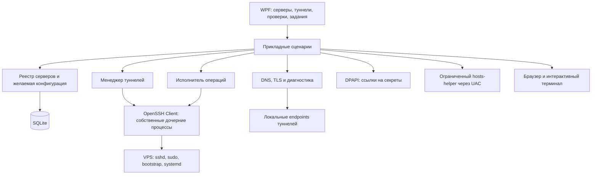

# OpenViya Ops: архитектура локального приложения управления инфраструктурой

Дата: 16.10.2026. Статус: архитектурное предложение для последующей реализации. Документ не содержит реализацию приложения и не меняет настройки компьютера, DNS или VPS.

Обновление: начата [первая реализация OpenViya Ops](../openviya-ops/README.md) — реестр существующих серверов, SSH-туннели и диагностика. Этот документ сохраняет целевую архитектуру; текущие возможности и ограничения перечислены в README приложения. Provisioning, DNS API и deployment APP ещё не реализованы.

Основание: [сетевая схема OpenViya](NETWORK-PLAN.md), [скрипт и инструкция настройки VPS](vps/README.md), [архитектура коммерческого бэкенда](../openviya-backend/docs/architecture.md). Рабочее название приложения — **OpenViya Ops**.

## 1. Назначение и границы

Локальное приложение владельца инфраструктуры: пользователь вводит IP VPS, выбирает роль и SSH-ключ, получает карточку сервера и управляет подключениями, туннелями, проверками и операциями обслуживания.

Первая версия предназначена для Windows 11 и одного оператора с несколькими или несколькими десятками VPS. Данные хранятся локально; интернет нужен для соединений с VPS, DNS и проверки сервисов. Общий облачный аккаунт и обязательный сервер самого OpenViya Ops не нужны.

Приложение управляет инфраструктурой OpenViya. Покупатели, платежи, коммерческие подписки и учёт устройств остаются в Java-бэкенде. Покупатели не получают доступ к OpenViya Ops, его SSH-ключам и административному API 3x-ui.

Граница ответственности:

| Возможность | В первой рабочей версии | Дальнейшее развитие |
| --- | --- | --- |
| Реестр VPS: IP, роль, регион, домены, порты, SSH-профиль | Да | Несколько операторов/окружений |
| Запуск, остановка и контроль SSH-туннелей | Да | Сложные маршруты через bastion/private network |
| Открытие панели и интерактивного SSH | Да, внешние браузер и терминал | Встроенный терминал при доказанной необходимости |
| DNS/TCP/SSH/TLS и базовые проверки состояния VPS | Да | Реальные автоматические VPN-пробы |
| Импорт существующей установки без переустановки | Да | Дополнительные типы серверов |
| Подготовка VPS и обслуживание через bootstrap | Второй этап, после готовности безопасных подключений | Дополнительные версионированные операции |
| Автоматическое изменение Timeweb DNS | Нет, сначала инструкции и проверка | Отдельный адаптер DNS API |
| Автоматическое подключение нод к CONTROL | Нет, сначала открытие панели и проверки | После проверки реального API и прав токенов |
| Deployment коммерческого APP и PostgreSQL | Нет | Отдельный адаптер deployment |

Цель первого этапа: добавить уже работающие VPS и открывать несколько панелей через правильные туннели без ручного поиска портов и запуска множества команд.

## 2. Выбор технологии

| Часть | Решение | Причина |
| --- | --- | --- |
| Приложение | C# / .NET 10 LTS | Поддерживаемая платформа для Windows и управления процессами |
| Интерфейс | WPF, MVVM | Нативное desktop-приложение без обязательного локального HTTP-сервера |
| Локальная БД | SQLite с миграциями | Профили, настройки, состояния заданий и история в одном файле |
| SSH/SCP/SFTP | Установленный Windows OpenSSH Client | Совместимость с существующими ключами и ssh-agent |
| Секреты приложения | Windows DPAPI, CurrentUser | Защита локально сохранённых токенов/паролей в контексте Windows-пользователя |
| Секрет SSH | Файл ключа вне БД и/или ssh-agent | Приложение не дублирует приватные ключи в своей БД |
| HTTP/TLS/DNS | Системные .NET API и отдельные сетевые адаптеры | Проверки без запуска браузера и отключения TLS |
| Владение SSH-процессами | Windows Job Object + реестр активных процессов | Предсказуемое завершение только собственных туннелей |
| Повышенные локальные права | Маленький отдельный helper для hosts | Основное приложение работает без администратора |

.NET 10 выбран как текущая LTS-линия на дату документа; при реализации использовать актуальный поддерживаемый patch, а не фиксировать в архитектуре номер patch. WPF ограничивает первую версию Windows. Кроссплатформенный интерфейс не входит в MVP; прикладная логика и интерфейсы адаптеров не должны зависеть от WPF.

Один desktop-процесс содержит интерфейс, прикладные сценарии и фоновые задачи. Не вводить отдельные микросервисы, локальный веб-бэкенд, PostgreSQL или постоянно установленный агент на каждом VPS. Существующие systemd и bootstrap на сервере продолжают выполнять свои задачи независимо от приложения.

Предлагаемая будущая структура решения: Desktop, Application, Model, Infrastructure и изолированный HostsHelper. Это части одного приложения, не пять сетевых сервисов. Создание исходников и solution в текущую задачу не входит.

## 3. Компоненты и связи

| Компонент | Ответственность |
| --- | --- |
| Server Registry | Карточки серверов, роли APP/CONTROL/VPN_NODE, связи нод с CONTROL, проверка адресов и портов |
| Connection Planner | Неизменяемый план конкретного подключения: адрес SSH, ключ, host key, target, локальный порт, TLS-имя |
| SSH Adapter | Диагностика доступности клиента, аутентификация, передача файлов и выполнение разрешённых команд |
| Tunnel Manager | Жизненный цикл SSH-процессов, конфликты портов, готовность target и переподключение |
| Diagnostics | Раздельные результаты DNS, SSH, TLS, HTTP, службы панели, Xray и реальной VPN-пробы |
| Operation Runner | Очередь типизированных операций, блокировка записи на VPS, прогресс и неизвестный результат |
| Bootstrap Adapter | Совместимость с конкретной версией bootstrap, prepare/finalize/LE/status, чтение фактической фазы |
| Panel Adapter | Позднее: проверенные методы административного API через туннель, без коммерческой логики |
| DNS Planner | Ожидаемые A/AAAA, сравнение с DNS, инструкции для Timeweb; в MVP без изменения записей |
| Secret Store | DPAPI, выдача секрета только нужной операции, исключение секретных результатов из журналов |
| Hosts Integration | План локальных записей имён панелей, вызов helper и безопасное удаление своих изменений |
| Audit/History | Локальная история действий и очищенные диагностические события |

Зависимости идут от UI к прикладным сценариям, от сценариев — к интерфейсам адаптеров. UI не собирает shell-команды, не читает SSH-ключи и не обращается к SQLite напрямую.

## 4. Модель данных

| Сущность | Основные данные | Примечание |
| --- | --- | --- |
| ProjectSettings | Базовый домен openviya.online, предпочтительные порты, таймзона, политика трея/восстановления | Значения по умолчанию, не факты о VPS |
| Server | UUID, имя, роль, регион, индекс ноды, IP/SSH-адрес, SSH-порт, connection profile, parent CONTROL | UUID не меняется при переименовании |
| SshIdentity | UUID, способ авторизации, путь к ключу/публичной части, fingerprint | Без содержимого приватного ключа и passphrase |
| HostTrust | Server UUID, адрес/порт, алгоритм и SHA-256 host key, время и способ подтверждения | Отдельно от пользовательского SSH-ключа |
| ServiceEndpoint | Сервер, назначение, схема, DNS-имя, порт, bind/access mode, secret base-path reference | VPN и панель — отдельные записи |
| DesiredConfiguration | Предложенные домены/порты/правила и revision | Редактирование не применяет конфигурацию |
| ObservedSnapshot | Фактические ОС, порты, службы, bootstrap phase, сертификат, timestamps | Статус может быть устаревшим или неизвестным |
| TunnelProfile | Endpoint, локальный bind 127.0.0.1, выбранный локальный порт, remote target | Профиль не означает запущенный процесс |
| TunnelRun | UUID запуска, PID+start time, состояние, попытки и последний результат проверки | Не использовать один PID как идентичность |
| OperationJob | UUID, тип операции, target server, revision плана, состояние, время и результат | Снимок цели и параметров неизменяем |
| SecretReference | Тип секрета, owner UUID и DPAPI-blob | Base path, пароли и API-токены вне обычных текстовых полей |
| AuditEvent | Кто из локальных профилей, операция, сервер, время UTC, очищенный результат | Не является защищённым централизованным аудитом |

Ключевые правила:

- SSH-адрес по умолчанию — введённый IP VPS. Он не зависит от домена панели, который на компьютере может быть перенаправлен в loopback.
- VPN-имя `usa-1.openviya.online` и имя панели `panel-usa-1.openviya.online` не взаимозаменяемы. CONTROL получает `panel-control.openviya.online`. APP не получает VPN inbound по умолчанию.
- Роль и регион предлагают имена, но пользователь может их изменить. IPv4/IPv6, punycode DNS, порт и CIDR валидируются отдельно; DNS-запись не содержит порт.
- Сохранённый порт установленного сервера, например 2053, имеет приоритет над новым default 38471 до явной операции изменения.
- Для APP действия bootstrap 3x-ui недоступны. Связи CONTROL → node не допускают циклов.
- Изменение IP/ключа/порта не перенаправляет уже работающий туннель. Новый план применяется новым подключением; изменение host key требует отдельного разбора.
- Одинаковый IP/SSH-порт в нескольких карточках выявляется как возможный дубль. Импорт не запускает соединения и операции автоматически.

## 5. Добавление сервера

Минимальная форма: IP, имя, роль, SSH-порт, пользователь и SSH identity. Для VPN_NODE дополнительно регион/индекс и основной CONTROL. Домены и VPN 443/панель 38471 подставляются как предложения из сетевой схемы.

Сценарий добавления работающего VPS:

1. Сохранить локальную карточку без изменения сервера.
2. Проверить OpenSSH Client, доступность ключа/агента и TCP SSH. SSH Server на компьютере администратора не требуется.
3. При первом соединении показать host-key fingerprint и предложить сверить его через консоль провайдера/ранее доверенный канал. Полученный по сети fingerprint сам по себе не подтверждает подлинность сервера.
4. После явного принятия host key проверить key-authentication и необходимые права. Ошибку ключа не маскировать как сетевую недоступность.
5. Read-only обнаружением получить ОС, bootstrap phase, фактические порты и наличие панели. Отсутствие bootstrap означает «сервер добавлен, автоматизация пока недоступна», а не разрешение установить всё заново.
6. Сопоставить фактическое состояние с ожидаемым. Предложить туннель на **найденный** порт панели и открыть её без переустановки.

Пароль первого root-входа и passphrase ключа в MVP вводятся в доверенном интерактивном терминале OpenSSH. Приложение не имитирует парольный терминал скрытым чтением stdin и не сохраняет пароль root. Если ключ ещё не установлен, мастер даёт точные шаги для внешнего терминала и затем повторяет проверку.

## 6. Жизненный цикл туннеля

Один SSH-процесс на туннель панели; для десятков серверов этого достаточно и проще отслеживать отказы. Командное соединение диагностики или обслуживания не переиспользуется как жизненно важный канал туннеля.

Параметры подключения: system ssh.exe, отсутствие удалённой shell-сессии для туннеля, явный local forward на 127.0.0.1, ExitOnForwardFailure, keepalive, BatchMode, StrictHostKeyChecking и отдельный known_hosts приложения. Агент не перенаправляется на VPS. Поддерживаемые опции проверяются для установленной версии Windows OpenSSH; не предполагать поддержку Unix multiplexing.

Remote target панели — `127.0.0.1:<фактический порт>`, что соответствует PermitOpen текущего bootstrap. В public/both режиме также используется loopback target. Никакого bind на 0.0.0.0 для локального туннеля и динамического SOCKS-прокси по умолчанию.

Последовательность запуска:

1. Зафиксировать connection plan и проверить отсутствие уже действующего запуска этого профиля.
2. Выбрать сохранённый локальный порт либо свободный из диапазона 20530–20629. Уникальность внутри приложения проверяется в SQLite и памяти.
3. Запустить OpenSSH и дождаться фактического bind. Между проверкой свободного порта и bind возможна гонка: при конфликте ограниченно подобрать другой порт. Чужой процесс не завершать.
4. Убедиться, что listener принадлежит своему запуску процесса. Проверить target через TLS/HTTP с доменным именем панели.
5. Отдельно показать «SSH подключён», «локальный listener готов», «target доступен», «сертификат корректен» и «страница панели доступна».
6. Только после необходимых проверок открыть доменный URL панели в браузере. Неверный base path отличать от недоступного туннеля.

ExitOnForwardFailure подтверждает создание forward, но не гарантирует достижимость remote target. Запущенный процесс или открытый TCP-порт не являются достаточным признаком исправной панели.

Пример назначения локальных портов:

| Сервер | Локальный порт | Remote target | Адрес браузера |
| --- | --- | --- | --- |
| CONTROL | 20530 | 127.0.0.1:38471 | https://panel-control.openviya.online:20530/BASE_PATH/ |
| USA-1 | 20531 | 127.0.0.1:38471 | https://panel-usa-1.openviya.online:20531/BASE_PATH/ |
| CA-1 | 20532 | 127.0.0.1:2053, если это старый порт | https://panel-ca-1.openviya.online:20532/BASE_PATH/ |

Состояния туннеля: Stopped → Starting → Verifying → Active; дополнительные состояния Degraded, Reconnecting, WaitingForAuthentication, BlockedByHostKey, Stopping и Failed. Статус API/Xray не подменяет транспортное состояние SSH.

Автовосстановление допускается после транспортного обрыва с задержкой и ограниченным числом попыток, например три попытки с backoff. При неверном ключе, изменённом host key или недоступном агенте повторные попытки прекращаются. Нельзя бесконечно обращаться к SSH и провоцировать Fail2ban. После сна/смены сети сначала проверить состояние процесса и маршрута, затем восстанавливать соединение.

При закрытии окна приложение может оставаться в трее — это явно показанная настройка. Команда «Выход» останавливает собственные туннели. Windows Job Object настроен на завершение дочерних tunnel-процессов при аварийном закрытии владельца; чужие ssh.exe и открытые пользователем терминалы не затрагиваются. После запуска приложения повторное подключение сохранённых профилей по умолчанию выключено.

## 7. Правильный HTTPS через туннель

Let’s Encrypt подтверждает имя панели, а не IP 127.0.0.1. Поэтому открытие `https://127.0.0.1:20531` не заменяет правильный доменный URL и не исправляется скачиванием сертификата.

Для обычного внешнего браузера в первой версии выбран механизм локальных hosts-записей **только имён панелей**:

- `panel-usa-1.openviya.online` локально разрешается в 127.0.0.1; браузер обращается к локальному порту туннеля с правильным Host/SNI.
- `usa-1.openviya.online` остаётся VPN-адресом и никогда не перенаправляется в loopback приложением.
- SSH всегда соединяется с сохранённым IP, поэтому изменение разрешения имени панели не направляет SSH на собственный компьютер.
- Сертификат проверяется браузером штатно. Приложение не добавляет доверенные CA в Windows и не запускает браузер с отключённой проверкой TLS.

Hosts-helper выполняет только добавление/удаление конкретных доменных записей в системном hosts, с проверкой формата и ownership. Основной UI работает без административных прав; UAC вызывается только для этого изменения, не при каждом SSH-подключении.

Протокол helper не принимает произвольный путь, исполняемую команду или произвольное содержимое файла. IPC локальный, доступен только ожидаемому пользователю/экземпляру. Доверенный helper поставляется с приложением, а не скачивается по ссылке из профиля сервера.

Менеджер hosts сохраняет журнал своих записей и резервную копию перед изменением, сохраняет чужие строки и комментарии. Чужая конфликтующая запись не перезаписывается молча. Удаление выполняется только для неизменённых записей, которыми владеет приложение. Одна запись может использоваться несколькими активными действиями; очистка — после освобождения последнего потребителя. После аварии изменения сверяются при следующем запуске; чужие изменения не откатываются автоматически.

Если UAC отклонён, приложение предлагает ручную строку hosts и оставляет раздельный статус «туннель работает, открытие в браузере не подготовлено». Не заменять его зелёным «всё готово». Проверка локального HTTP-прокси/кэша DNS помогает объяснить ситуацию, когда браузер всё ещё идёт по публичному адресу.

Внутренние проверки приложения обходятся без системного hosts: URI содержит реальное имя панели, а HTTP transport соединяется с локальным портом туннеля. Проверка hostname/CA остаётся включённой; автоматические redirect вне ожидаемого origin запрещены. Такой режим используется и будущим Panel Adapter.

## 8. Ключи, доверие и локальные секреты

- Предпочтителен OpenSSH ssh-agent. Приложение показывает наличие нужного ключа, но загрузку ключа с passphrase выполняет интерактивный ssh-add. Управление системной службой agent не происходит скрытно.
- Для каждого SSH-профиля явно выбирается identity. Generated SSH config приложения не включает произвольные ProxyCommand/LocalCommand из импортированных данных. Профили реестра не являются исполняемым SSH config.
- known_hosts приложения отделён от глобального файла пользователя. После подтверждения fingerprint дальнейшие соединения требуют строгого совпадения. Смена IP/переустановка VPS не разрешают автоматически удалить старый host key и принять любой новый.
- Приватные SSH-ключи не копируются в SQLite, export или на VPS. Приложение хранит ссылку на путь/identity и публичный fingerprint; перенос ключей на другой компьютер выполняется отдельно.
- Panel base path, пароль панели и API-токены при необходимости шифруются DPAPI CurrentUser. По умолчанию браузер сам выполняет вход в панель с 2FA; хранение её пароля не обязательно для запуска туннеля.
- SQLite, known_hosts, файлы конфигурации и логи ограничены ACL текущего Windows-пользователя. DPAPI не защищает от вредоносного кода с доступом этого же пользователя или администратора.
- Export по умолчанию содержит только профили без секретов. DPAPI-blob нельзя считать переносимым между компьютерами/учётными записями: после импорта требуется повторно выбрать ключи и ввести секреты.
- Операция получения credentials с VPS возвращает секретный результат: он не попадает в обычный журнал и диагностический export. Копирование секрета в буфер обмена — отдельное явное действие, очистка возможна только если буфер не был изменён другим приложением.

## 9. Исполнение операций на VPS

Основные операции задаются типами, не строками свободного ввода: InspectServer, CheckDns, CheckTls, StartTunnel, StopTunnel, OpenPanel, OpenTerminal, BootstrapPrepare, BootstrapFinalize, SetupLetsEncrypt, CheckRenewal и CreateBackup. RestartPanel и Reboot — отдельные обслуживающие операции с показанным влиянием. RollbackAccess — аварийная операция, а не обычная кнопка возврата формы.

Для чтения и запуска туннеля достаточно явного действия пользователя; дополнительных подтверждений на каждом шаге нет. Перед изменением SSH/UFW, запуском provisioning, перезапуском Xray или reboot отображается конкретный план: какой VPS/IP, что изменится, как это затронет соединения и какой есть путь восстановления. Подтверждается этот план, а не абстрактное «разрешить управление всем».

Исполнение:

1. UI передаёт типизированные параметры; Application проверяет роль сервера, capabilities и revision.
2. Process Runner запускает исполняемый файл напрямую через список аргументов, без промежуточных PowerShell/cmd для фоновых операций.
3. SSH remote command всё равно интерпретируется удалённой shell: локальный ArgumentList не решает remote shell injection. Допускаются только фиксированные команды/пути и валидированные аргументы с корректным POSIX quoting; более сложные параметры передаются как данные по stdin в доверенный helper.
4. Передача файлов выполняется по SSH/SFTP/SCP в собственный staging-каталог. Привилегированный запуск использует проверенную root-owned копию, а не файл, содержимое которого может измениться во время исполнения.
5. Работает одна изменяющая операция на VPS; bootstrap дополнительно сохраняет свою серверную блокировку. Read-only проверки имеют ограниченный параллелизм, например три сервера одновременно.
6. Секреты не передаются в argv, shell history или обычный stdout. У секретных ответов отдельный канал обработки; нельзя полагаться только на regex-маскирование уже записанных логов.

Внешний интерактивный терминал остаётся отдельным пользовательским инструментом. Свободный ввод shell не встраивается в автоматический Operation Runner и не выдаётся за воспроизводимую операцию приложения.

Отмена локального процесса не равна отмене команды на VPS. При потере SSH результат записи может быть UnknownOutcome. Повтор сначала читает фазу и фактическое состояние; prepare, finalize, reboot и сетевые изменения не перезапускаются автоматически вслепую. При неизвестном результате показывается время последнего достоверного наблюдения и путь восстановления.

## 10. Интеграция с текущим bootstrap

Приложение поставляет конкретную проверенную версию скрипта с manifest и SHA-256. Не исполнять latest install.sh из интернета. Версия клиентского адаптера, хеш скрипта и capabilities записываются в историю операции.

Текущий скрипт имеет команды prepare, finalize, status, setup-letsencrypt, renew-cert, rollback и deploy-cert. deploy-cert — внутренняя часть renewal, её не нужно выводить как основное действие. Скрипт не предоставляет универсального JSON API и не реализует настройку DNS, частную сеть или готовый VPN inbound.

Для read-only обнаружения первой версии использовать небольшой версионированный диагностический адаптер с фиксированными запросами: bootstrap phase, systemd state, listener, фактические параметры установленной панели и сертификат. Он возвращает структурированный снимок и не исполняет содержимое конфигов на компьютере. Секретный credentials-файл запрашивается отдельно. Человеческий вывод status сохраняется как диагностика, но не является единственным машинным контрактом.

При последующей реализации целесообразно добавить в bootstrap поддерживаемый inspect --json с version/capabilities. Это отдельная будущая доработка скрипта, а не уже существующая команда.

### Настройка нового VPS во втором этапе

Последовательность состояний задания:

`Draft → Preflight → AwaitingHostTrust/Auth → PrepareRunning → WaitingForNewKeySession → FinalizeRunning → Verifying → Complete`.

Ошибки переводят задание в Failed, UnknownOutcome, WaitingForUserAction или RollbackObserved. «Процесс завершился» не означает Complete.

Правила оркестрации:

- Сначала определить, новый ли VPS. При existing/pending/complete не запускать prepare заново; предложить обнаружение, продолжение допустимой фазы или обслуживание.
- Подготовка требует доступного исходного SSH-сеанса и аварийной консоли провайдера. Если исходная авторизация парольная, использовать явный интерактивный шаг, пока не готов поддерживаемый key-auth канал.
- После prepare открыть **новое отдельное SSH-соединение** как vpsadmin и проверить ключ. Нельзя имитировать новый вход сменой имени в том же процессе.
- Finalize запускается в новом соединении с сохранением реального SSH_CONNECTION по контракту скрипта. Исходный административный сеанс остаётся доступным до проверки результата.
- Показывать серверную фазу и остаток окна rollback. Локальный отсчёт приблизителен; серверный systemd-таймер — источник истины. Разницу часов учитывать, не отменять защиту по локальному времени.
- Продление окна rollback — явное отдельное действие, не бесконечное автоматическое продление каждые 30 секунд.
- Таймер снимает только успешно завершившийся finalize. Приложение не отключает защитный таймер просто потому, что HTTPS панели ответил.
- При RollbackObserved не возобновлять автоматически изменяющие действия. Объяснить, что SSH восстановлен, UFW отключён и панель остановлена; привести шаги восстановления из инструкции.

SetupLetsEncrypt показывает выбранный **домен панели**, email, необходимость внешнего TCP 80 и возможный перерыв Xray. Она не меняет автоматически порт/режим доступа и не заменяет подключение ноды к CONTROL. CheckRenewal использует dry-run, не force-renewal.

APP-профиль получает диагностику SSH/HTTPS и ссылки на его сервисы. Provisioning 3x-ui для APP блокируется по роли. Production deployment Java/Compose требует своего адаптера и не подменяется bootstrap ноды.

## 11. Проверки и отображение состояния

| Проверка | Что доказывает | Чего не доказывает |
| --- | --- | --- |
| Публичные DNS A/AAAA/NS | Куда указывает запись у выбранного resolver | Готовность сервиса и сходимость всех кэшей |
| TCP SSH | Доступность порта | Правильность ключа и личности сервера |
| SSH host key + key-auth | Доверенное аутентифицированное соединение | Наличие sudo и работоспособность Xray |
| Локальный listener | Forward создан своим процессом | Доступность remote target |
| TLS по доменному имени | CA, имя, срок и соединение через выбранный маршрут | Корректность base path и VPN-трафика |
| HTTP панели | Доступность нужного web endpoint | Xray running и пользовательский доступ |
| Проверенный API/серверное состояние Xray | Состояние процесса/ядра на момент проверки | Успешное подключение внешнего VPN-клиента |
| Внешняя VPN-проба | Работоспособность тестового профиля из конкретной сети | Доступность всех пользователей и всех сетей |

Результат каждого probe содержит ObservedAt, endpoint/маршрут, timeout и классификацию ошибки. «Не проверено», «недостаточно прав», «устарело» и «недоступно» — разные состояния. Отсутствие monitor API-токена не превращается в красный «Xray упал» и не маскируется зелёным «готов».

Проверки запускаются по действию пользователя и с умеренным фоновым интервалом только для наблюдаемых/активных серверов. Все даты хранятся в UTC, показываются в настроенной локальной таймзоне; интервалы измеряются монотонным временем.

## 12. Логические разделы интерфейса

| Раздел | Содержимое |
| --- | --- |
| Серверы | Реестр, роль/регион, SSH/TLS/сервисные статусы и время проверки; добавить/импортировать |
| Карточка сервера | IP, ключ, домены/порты, фактическая конфигурация, открыть SSH/панель, разрешённые операции |
| Туннели | Источник → target, локальный порт, состояние процесса и target, запустить/остановить |
| Схема и DNS | APP → CONTROL → ноды, ожидаемые записи и отличия от фактического DNS |
| Задания и история | Прогресс provisioning, rollback window, ошибки и UnknownOutcome без раскрытия секретов |
| Настройки и доверие | Базовый домен, identities, host keys, hosts-интеграция, export, tray-политика |

Это описание информационной структуры, не готовый визуальный дизайн. Для запуска туннеля не требуется проходить мастер настройки VPS. В карточке одновременно видны ожидаемые и обнаруженные параметры; редактирование формы не меняет сервер само по себе.

## 13. Хранение, установка и обновление приложения

Предлагаемое место пользовательских данных — `%LOCALAPPDATA%/OpenViya/Ops/`: SQLite, очищенные логи, отдельный known_hosts, конфигурации SSH, сведения о hosts ownership и временные transfer-манифесты. Приватные SSH-ключи остаются в выбранном пользователем месте. Runtime PID нельзя восстанавливать как доверенный процесс из старой БД.

Один активный экземпляр на Windows-пользователя: mutex и ограничения БД предотвращают двойной запуск одного туннеля. После аварии задания восстанавливаются как требующие сверки, а не автоматически успешные. Миграция БД сопровождается локальной копией; перед обновлением приложения собственные туннели останавливаются либо обновление откладывается.

Основной executable запускается без UAC. Подписанный installer/update и hosts-helper планируются отдельно; изменение системных компонентов не является условием чтения реестра. Автоматическая синхронизация секретов, телеметрия и автозапуск Windows по умолчанию отсутствуют. Выпуск приложения должен обновлять и поставляемый runtime, если используется self-contained package.

Закрытие OpenViya Ops не останавливает сервисы VPS, Certbot и серверные backup. SSH-туннели принадлежат локальному приложению и при полном выходе закрываются. Уже запущенная удалённая операция может продолжиться и требует сверки состояния после переподключения.

## 14. Этапы реализации и критерии приёмки

| Этап | Результат | Условие готовности |
| --- | --- | --- |
| 1. Локальный фундамент | Профили, SQLite, secrets references, SSH trust и импорт существующих VPS | Нет секретов в export/логах; адрес и ключ не путаются между карточками |
| 2. Рабочие туннели | Управление процессами, порты, TLS, hosts-helper и браузер | Несколько панелей открываются одновременно по правильным именам без TLS bypass |
| 3. Диагностика | DNS/SSH/TLS/service snapshots, история и stale states | Различаются транспорт, панель, Xray и непройденная VPN-проба |
| 4. Безопасные операции | Типизированный runner и совместимость bootstrap | Отмена/обрыв не вызывает слепой повтор записи; target и влияние видны заранее |
| 5. Provisioning и обслуживание | prepare/finalize, LE, backup, restart с восстановлением | Реальный новый вход, работа rollback и импорт уже установленного VPS проверены |
| 6. Дополнительные адаптеры | Timeweb API, проверенное подключение нод, частная сеть, APP deployment | Каждая интеграция имеет отдельный контракт, permissions и стендовые тесты |

MVP для повседневной работы — этапы 1–3. Полная автоматизация подготовки VPS начинается после них; не откладывать полезный реестр и туннели до готовности всех интеграций.

Обязательные проверки реализации:

- Два VPS с одинаковым remote panel port и третий со старым 2053 открываются через разные local ports. Кнопка конкретной карточки никогда не открывает соседнюю панель.
- Занятый порт, портовая гонка и второй экземпляр приложения не приводят к завершению чужого процесса или подключению к чужому listener.
- Неверный host key блокирует соединение; host-key acceptance не сводится к отключению проверки. Неверный ключ не вызывает бесконечный reconnect.
- SSH-процесс жив, но remote panel выключена: интерфейс показывает деградацию target. Неверный TLS hostname и просроченный сертификат не обходятся автоматически.
- UAC отказан, hosts уже изменён вручную или файл защищён: приложение сохраняет чужие записи и объясняет, какая часть запуска не завершена.
- Сон Windows, смена сети, аварийное закрытие и полный выход не оставляют принадлежащие приложению скрытые туннели; ручные SSH-сеансы пользователя сохраняются.
- Пути с пробелами/Unicode и значения с shell-метасимволами не превращаются в выполнение локальной/удалённой команды.
- Обрыв после prepare или во время finalize приводит к сверке фазы и таймера. Приложение не повторяет prepare на существующей установке и не снимает rollback досрочно.
- Отсутствие sudo, несовместимый bootstrap и APP-профиль блокируют неподдерживаемые изменения, сохраняя диагностику и ручной SSH.
- Secret-result, diagnostic export, crash-report и command preview не раскрывают ключи, токены, пароль панели и индивидуальный base path.

## 15. Допущения и будущие решения

Для этого проекта выбраны Windows 11, один оператор, существующий OpenSSH, внешний браузер/терминал, локальный реестр и отсутствие облачного аккаунта. Это позволяет реализовать небольшое полезное приложение без изменения архитектуры коммерческого сервиса.

Перед реализацией проверить установленную версию Windows OpenSSH и доступность agent, выбрать способ подписанной доставки helper и приложения, согласовать формат диагностического снимка с bootstrap. Эти вопросы не мешают реестру и ручным подключениям, но не должны решаться скрытым отключением проверок.

Переход к macOS/Linux, совместная работа команды, централизованный аудит, удалённый доступ к самому OpenViya Ops и автоматическое хранение SSH-passphrase — отдельные изменения архитектуры. Они не предполагаются словом «мини-приложение».

## Источники

- [Microsoft: .NET support policy](https://dotnet.microsoft.com/en-us/platform/support/policy/dotnet-core), [WPF](https://learn.microsoft.com/en-us/dotnet/desktop/wpf/overview/).
- [Microsoft: OpenSSH keys и agent](https://learn.microsoft.com/en-us/windows-server/administration/openssh/openssh_keymanagement). Для приложения нужен SSH Client; серверная часть Windows не требуется.
- [OpenSSH: ssh](https://man.openbsd.org/ssh), [ssh_config](https://man.openbsd.org/ssh_config). Доступность конкретных опций проверяется на Windows-клиенте.
- [Microsoft: ProcessStartInfo.ArgumentList](https://learn.microsoft.com/en-us/dotnet/api/system.diagnostics.processstartinfo.argumentlist), [Windows Job Objects](https://learn.microsoft.com/en-us/windows/win32/procthread/job-objects).
- [Microsoft: DPAPI/ProtectedData](https://learn.microsoft.com/en-us/dotnet/standard/security/how-to-use-data-protection).
- [Сетевая схема проекта](NETWORK-PLAN.md), [bootstrap VPS](vps/README.md), [контракт 3x-ui](../openviya-backend/docs/integrations/3x-ui/README.md).
