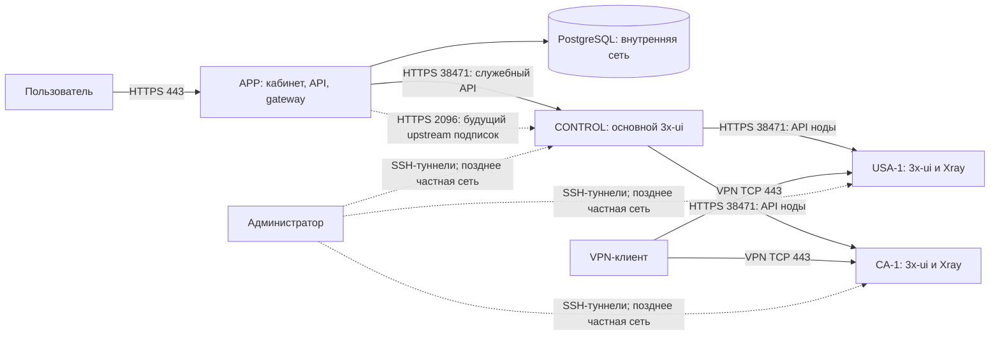

# Сетевая схема OpenViya: домены, серверы, порты и доступ

Дата: 16.10.2026. Статус: рекомендуемая схема размещения и порядок настройки. Это не отчёт о развёртывании: реальные DNS-записи, firewall провайдера и серверы этим документом не изменены. Адреса IP и секреты намеренно не приведены.

Основание: [архитектура бэкенда](../openviya-backend/docs/architecture.md), [контракт интеграции 3x-ui](../openviya-backend/docs/integrations/3x-ui/README.md) и [текущий скрипт VPS](vps/README.md). Домен — **openviya.online**. Ранее использованный openviya.space был примером и в этой схеме не применяется.

Для управления этой инфраструктурой с компьютера администратора подготовлена [архитектура локального приложения OpenViya Ops](LOCAL-OPS-APP-ARCHITECTURE.md). [Первая реализация](../openviya-ops/README.md) включает реестр VPS, SSH-туннели и диагностику; автоматизация provisioning и интеграция с bootstrap остаются следующими этапами.

## 1. Основное решение

- VPN-клиенты подключаются к `usa-1.openviya.online:443`, `ca-1.openviya.online:443` и следующим нодам по той же схеме.
- Панели нод используют `panel-usa-1.openviya.online:38471` и `panel-ca-1.openviya.online:38471`. Панель основного центра управления — `panel-control.openviya.online:38471`.
- Сайт, кабинет, API и публичные подписочные ссылки обслуживаются отдельным сервером приложения на HTTPS 443.
- Бэкенд, основной 3x-ui и VPN-ноды размещаются на разных VPS. На сервере приложения нет 3x-ui и пользовательского VPN-трафика.
- Для начала доступ между серверами — HTTPS с проверкой сертификатов и точечными IP-правилами. Доступ человека к панелям — SSH-туннель. Целевое усиление — отдельная частная сеть управления с ACL.
- Let’s Encrypt выпускается для точных имён сервисов. На нодах сохраняется выбранный HTTP-01 через TCP 80 и автоматическое продление.

VPN остаётся на 443. Перенос на произвольный порт технически допустим, но в сетях с ограничениями исходящих соединений может уменьшить доступность. Красивый URL панели без номера порта не является причиной менять клиентский VPN-порт.

Разные DNS-имена на одном IP не изолируют сервисы: запрос к IP:38471 не становится безопаснее от названия поддомена. Ограничения выполняются firewall, настройками listener, аутентификацией и правами приложения. DNS не выбирает порт.

## 2. Роли серверов и направления соединений

| Роль | Что размещается | Что на ней не размещается |
| --- | --- | --- |
| APP | HTTPS-прокси, сайт/кабинеты, Java-бэкенд, PostgreSQL; первоначально на одном VPS | 3x-ui, VPN inbound, пользовательский транзит |
| CONTROL | Основной 3x-ui, управление нодами; позднее закрытый upstream подписок | Платежи, коммерческие правила OpenViya, публичный VPN inbound |
| USA-1 | 3x-ui/Xray ноды, VPN inbound, локальная БД панели | PostgreSQL OpenViya, коммерческие правила, сайт |
| CA-1 | То же для Канады | То же |



Каждая VPN-нода имеет собственную панель; основной 3x-ui обращается к API этих панелей. Это соответствует [документации multi-node для закреплённого v3.10.2](https://github.com/MHSanaei/3x-ui/blob/v3.10.2/docs/content/docs/en/operations/multi-node.mdx). Точная синхронизация, права токенов и применение изменений требуют стендовых проверок из контракта проекта. Не создавать взаимные циклы CONTROL → USA-1 → CONTROL.

CONTROL управляет конфигурацией и состоянием; VPN-трафик идёт непосредственно на выбранную ноду. Недоступность APP или CONTROL не должна превращать их в обязательный промежуточный узел трафика. При этом автономное истечение доступа и судьба открытых сессий при отказе управления ещё должны быть измерены, а не предполагаться.

## 3. Домены и DNS

| Имя | Куда направить A | Назначение и внешний порт | Когда создавать |
| --- | --- | --- | --- |
| `openviya.online` | APP_PUBLIC_IP | Основной сайт, HTTPS 443 | При развёртывании сайта |
| `www.openviya.online` | CNAME на `openviya.online` | Перенаправление на основной сайт | Вместе с сайтом |
| `app.openviya.online` | APP_PUBLIC_IP | Кабинет пользователя, HTTPS 443 | При развёртывании кабинета |
| `api.openviya.online` | APP_PUBLIC_IP | Публичное API OpenViya, HTTPS 443 | При настройке production API |
| `sub.openviya.online` | APP_PUBLIC_IP | Только gateway подписок, HTTPS 443 | После готовности gateway |
| `admin.openviya.online` | APP_PUBLIC_IP | Кабинет сотрудников, HTTPS 443, ограниченный доступ | После готовности кабинета |
| `panel-control.openviya.online` | CONTROL_PUBLIC_IP | Основной 3x-ui, HTTPS 38471, ограниченный доступ | При создании CONTROL |
| `usa-1.openviya.online` | USA_1_PUBLIC_IP | VPN, TCP 443 | При создании USA-1 |
| `panel-usa-1.openviya.online` | USA_1_PUBLIC_IP | Панель/API ноды, HTTPS 38471, ограниченный доступ | Вместе с USA-1 |
| `ca-1.openviya.online` | CA_1_PUBLIC_IP | VPN, TCP 443 | При создании CA-1 |
| `panel-ca-1.openviya.online` | CA_1_PUBLIC_IP | Панель/API ноды, HTTPS 38471, ограниченный доступ | Вместе с CA-1 |

APP_PUBLIC_IP и остальные обозначения — подставляемые значения, не буквальный текст A-записи. Имя вида `usa-1` обозначает конкретную ноду: новая нода получает `usa-2`. При нескольких городах можно заранее расширить схему до `usa-nyc-1`; уже выданные клиентам имена без необходимости не менять.

В Timeweb:

1. Проверить, что NS домена соответствуют DNS-провайдеру, в панели которого меняются записи. Запись в неавторитетной зоне не влияет на публичный DNS.
2. В «Поддомены» создать `usa-1` и `panel-usa-1`, указав для обоих IPv4 одного американского VPS. Повторить для Канады и CONTROL.
3. TTL на этапе настройки оставить 600 секунд, как в текущей панели. Не считать TTL гарантированным временем завершения всех изменений.
4. Не указывать в значении A-записи `https://`, порт или URL-путь. Не создавать SRV в расчёте, что VPN-клиенты сами найдут нужный порт: порт передаётся в клиентской конфигурации.
5. AAAA добавлять после проверки рабочего IPv6, маршрута, listener и firewall. Ошибочная AAAA может нарушить и клиентские подключения, и выпуск сертификата.
6. Существующие MX/TXT почты сохранить. Если вводится ограничивающая CAA, разрешить выпуск Let’s Encrypt; DNSSEC включать с корректной цепочкой DS у регистратора.

Сначала достаточно создать записи реально используемых сервисов. Не направлять ещё неготовые имена на чужой сервис или временную панель. Для VPN и проверки сертификатов использовать прямой DNS без HTTP/CDN-прокси. Обычный веб-прокси CDN не является универсальным прокси для произвольного TCP/UDP: [ограничения Cloudflare](https://developers.cloudflare.com/dns/proxy-status/limitations/).

Веб-имена APP могут обслуживаться одним HTTPS-прокси на одном IP:443 по имени Host/SNI. Для кабинета удобно проксировать `/api/` в бэкенд на том же origin `app.openviya.online`, даже если отдельный `api.openviya.online` также используется интеграциями. Если браузер обращается к отдельному API-origin, явно настроить CORS, cookie, CSRF и доверенные Origin; не разрешать все origins вместе с credentials.

## 4. Порты и firewall для первоначального развёртывания

Ниже — входящие соединения с публичной сети. Ответный трафик established/related и необходимые сетевые ICMP/ICMPv6 сообщения сохраняются. Таблица не означает применение её к работающим серверам без проверки текущего доступа.

| Сервер | Порт/протокол | Допущенный источник | Что обслуживает |
| --- | --- | --- | --- |
| APP | 22/TCP | Администратор, по возможности его IP/сеть | SSH по ключу |
| APP | 80/TCP | Интернет | ACME HTTP-01 и перенаправление обычного HTTP |
| APP | 443/TCP | Интернет; admin-vhost ограничивается отдельно | Сайт, кабинет, API, gateway |
| APP | 8080/TCP, 5432/TCP | Публичный доступ запрещён | Java и PostgreSQL во внутренней сети |
| CONTROL | 22/TCP | Администратор | SSH по ключу |
| CONTROL | 80/TCP | Интернет | Certbot standalone, только во время проверок |
| CONTROL | 38471/TCP | **APP_PUBLIC_IP/32** | API основного 3x-ui |
| CONTROL | 2096/TCP | Сейчас закрыт; позднее только APP_PUBLIC_IP/32 | Отдельный upstream подписок |
| CONTROL | 443/TCP, весь UDP | Закрыты, пока нет отдельного назначения | Пользовательского VPN здесь нет |
| USA-1 / CA-1 | 22/TCP | Администратор | SSH по ключу |
| USA-1 / CA-1 | 80/TCP | Интернет | Certbot standalone, только во время проверок |
| USA-1 / CA-1 | 443/TCP | Интернет | VPN inbound |
| USA-1 / CA-1 | 38471/TCP | **CONTROL_PUBLIC_IP/32** | Управление нодой из основного 3x-ui |
| USA-1 / CA-1 | 2096/TCP, прочие порты, весь UDP | Закрыты | Ненужные слушатели отсутствуют |

Для IPv6 нужны соответствующие IPv6-правила и /128 вместо /32. Один IPv4 CIDR не разрешает IPv6. Источник для allowlist — фактический исходящий IP сервера после NAT, а не обязательно адрес, показанный у его сетевого интерфейса.

TCP 443 и UDP 443 — разные порты с точки зрения правил транспорта. Если позднее появится UDP-протокол, открыть только нужный UDP-порт и создать соответствующий inbound; разрешение UDP не создаёт сервис. TCP VPN может переносить пользовательский UDP внутри своего соединения без публичного UDP listener — это зависит от выбранного протокола.

Правила задаются на двух уровнях: firewall провайдера и firewall хоста. Исходящие соединения на первом этапе разрешены; для VPN произвольное ограничение egress может ломать нужные клиентам назначения. Запрет доступа VPN-клиентов к private/link-local/metadata выполняется также в маршрутизации Xray и проверяется реальным клиентом.

Ограничение `admin.openviya.online` на общем APP:443 задаётся в HTTPS-прокси/приложении: обычный портовый firewall не различает имена внутри одного IP:443. Отдельное имя не заменяет роли, 2FA и аудит административных действий.

### Docker на APP

Текущий [compose.yml](../openviya-backend/compose.yml) публикует Java как `${SERVER_PORT:-8080}:8080`. Для production это необходимо изменить: при HTTPS-прокси на хосте использовать `127.0.0.1:${SERVER_PORT:-8080}:8080`; при прокси в Docker не публиковать порт app на хост вообще, оставив общую внутреннюю сеть с прокси. PostgreSQL сейчас не имеет host ports — это сохранить.

Одного UFW deny для опубликованного Docker-порта недостаточно: Docker обрабатывает такие соединения иначе, что описано в [официальной документации Docker](https://docs.docker.com/engine/network/packet-filtering-firewalls/#docker-and-ufw). Не отключать автоматически управление Docker firewall без полноценной замены. Проверять доступ с другого хоста, а не только через `ss`.

## 5. Доступ к панелям и API

Первоначальная схема минимизирует открытый доступ и соответствует возможностям текущего скрипта:

- APP обращается к `https://panel-control.openviya.online:38471/<base-path>/...` с отдельным служебным токеном. В production не оставлять значение адаптера по умолчанию `http://localhost:2053/`.
- CONTROL обращается к `https://panel-usa-1.openviya.online:38471/<base-path>/...` и аналогично к Канаде. У каждой ноды собственный токен; `TLS verify` включён.
- Человек входит в панели через SSH-туннели. Ему не требуется открывать 38471 всему интернету или добавлять динамический домашний IP в API-allowlist.
- Реальные base path и API-токены находятся только в секретной конфигурации. Роли/scopes проверяются на выбранной сборке: название `node-sync` само по себе не доказывает нужные полномочия.
- Основной контроль сроков, платежей и прав остаётся в OpenViya. Панель является внешней технической системой; не выдавать её учетные записи покупателям.

Для нового USA-1 после настройки DNS и firewall провайдера:

```bash
bash /root/bootstrap-vps.sh prepare \
  --key-file /root/vpsadmin.pub \
  --domain panel-usa-1.openviya.online --acme-email YOUR_EMAIL \
  --panel-port 38471 --panel-access both \
  --panel-cidr CONTROL_PUBLIC_IP/32 --vpn-tcp 443 --vpn-udp ''
```

Для нового CONTROL:

```bash
bash /root/bootstrap-vps.sh prepare \
  --key-file /root/vpsadmin.pub \
  --domain panel-control.openviya.online --acme-email YOUR_EMAIL \
  --panel-port 38471 --panel-access both \
  --panel-cidr APP_PUBLIC_IP/32 --vpn-tcp '' --vpn-udp ''
```

Заменить обозначения IP и email реальными значениями. После prepare в новом SSH-сеансе выполнить finalize по [инструкции VPS](vps/README.md). В режиме `both` listener публичный, но UFW допускает к API только указанный источник. Широкое правило `allow 38471/tcp` вместе с узким правилом уничтожает ожидаемое ограничение — проверять итоговый набор.

На уже установленных VPS **не повторять prepare**. Команда setup-letsencrypt меняет TLS, но не переводит `tunnel` в `both`, не добавляет CONTROL и не меняет сохранённый порт. Перевод установленной ноды в сетевое управление требует отдельного изменения listener и firewall с проверкой через консоль. Старый 2053 можно временно сохранить и явно указать в CONTROL; не объявлять его автоматически заменённым на 38471.

Не запускать bootstrap 3x-ui на APP: он предназначен для чистой ноды/панели и откажет при уже работающем Docker. Для APP нужен отдельный production deployment.

Для человека сохраняется доменное имя панели в URL туннеля. В локальном hosts компьютера администратора допускается `127.0.0.1 panel-usa-1.openviya.online`; VPN-имя `usa-1.openviya.online` остаётся в публичном DNS. Детальные команды и локальные порты 20530/20531 приведены в [README VPS](vps/README.md#открытие-панели-и-несколько-серверов).

### Целевая частная сеть управления

После проверки начальной схемы рекомендована отдельная сеть управления между APP, CONTROL, нодами и административным устройством: например WireGuard с индивидуальными ключами и адресами. Она не используется для переноса пользовательского VPN-трафика.

В ней разрешаются только APP → CONTROL и CONTROL → нужные API нод, плюс административный доступ. Не выдавать всем нодам произвольный доступ к APP, PostgreSQL и другим нодам. Ограничивать сервисы по интерфейсу/адресу и firewall, а не только наличием ключа сети.

При таком переходе публичные правила 38471 удаляются после проверки. Имена панелей внутри management-сети разрешаются в частные адреса; HTTPS продолжает проверять имя домена и CA. С HTTP-01 публичные A/AAAA имён панелей сохраняют адреса соответствующих VPS и публичный 80; внутреннее разрешение задаётся отдельным DNS/hosts. Для Java в контейнере настройки DNS/hosts хоста не наследуются автоматически — настроить контейнер отдельно.

WireGuard требует отдельно выбранного UDP endpoint и правил, зависящих от топологии. Это дополнительная настройка, **текущий bootstrap её не выполняет**. Сначала подтвердить соединение и аварийный SSH/консоль, затем закрывать старый путь. При дальнейшей настройке mTLS master → node можно дополнительно привязать доверие к клиентскому сертификату; это не текущая конфигурация скрипта.

## 6. Клиентские адреса, inbound и подписки

Для США:

| Поле | Значение |
| --- | --- |
| API-адрес панели в CONTROL | `panel-usa-1.openviya.online`, HTTPS, 38471, индивидуальный base path |
| Listener VPN inbound | Адрес интерфейса/0.0.0.0, TCP 443; IPv6 проверяется отдельно |
| Адрес, выдаваемый VPN-клиентам | `usa-1.openviya.online` |
| Порт, выдаваемый клиентам | 443 |
| Публичная подписочная ссылка | `https://sub.openviya.online/subscriptions/{opaqueToken}` |

В 3x-ui адрес для клиентского конфига настраивать через подходящий host override/managed host у inbound; не подменять им адрес API панели. Приёмка — скачать готовую конфигурацию и проверить, что в ней действительно `usa-1.openviya.online:443`, а не IP панели или `panel-usa-1...:38471`. Для Канады повторить с `ca-1`.

Протокол VPN ещё не закреплён развертыванием. Для VLESS + REALITY адрес подключения, target и SNI — разные настройки. `usa-1.openviya.online` задаёт адрес ноды, но не становится автоматически подходящим SNI/target. Для обычного TLS нужен сертификат, соответствующий TLS-имени, которое проверяет клиент. Сертификат `panel-usa-1...` этого автоматически не обеспечивает.

Пользовательская подписочная ссылка должна вести в OpenViya. Маршрут `/subscriptions/{opaqueToken}` уже предусмотрен [контрактом gateway](../openviya-backend/docs/integrations/3x-ui/README.md#6-gateway-подписки-и-happ); домен `sub.openviya.online` предлагается как её отдельный HTTPS origin. Прокси на этом имени пропускает только явно разрешённые методы/пути gateway. Он не публикует `/panel/api`, login, административные страницы и произвольные upstream URL.

Gateway сначала проверяет право пользователя, затем обращается к закрытому подписочному серверу CONTROL с сохранением проверок устройств/HWID. Общий административный Bearer-токен нельзя отправлять клиенту или использовать как публичный токен подписки. Прямые upstream URL, HTML-страницы панели, альтернативные форматы и redirect headers не должны создавать обход gateway.

После готовности gateway допустим upstream вида `https://panel-control.openviya.online:2096/<subPath>/...` с TLS и сертификатом этого имени; 2096 разрешается только APP. Это отдельный сервер подписок 3x-ui, не административный API. Его можно включить только после проверки auth/HWID/ответов по контракту. Текущий bootstrap подписки отключает и порт 2096 не открывает. На VPN-нодах публичный сервер подписок не нужен.

Happ получает ссылку OpenViya, а не индивидуальный URL панели. Работоспособность crypt5 для этого origin ещё требуется подтвердить. Кэш gateway и прокси не должен смешивать ответы разных пользователей/устройств или обходить проверки. Токены в пути и содержимое конфигов исключаются из обычных access/debug логов.

## 7. TLS и продление

| Сервис | Имена сертификата | Кто применяет новый сертификат |
| --- | --- | --- |
| HTTPS-прокси APP | Только обслуживаемые имена сайта/кабинетов/API/gateway | Конфигурация прокси и её renewal/reload |
| CONTROL | `panel-control.openviya.online` | Certbot + deploy hook bootstrap |
| USA-1 | `panel-usa-1.openviya.online` | То же на USA-1 |
| CA-1 | `panel-ca-1.openviya.online` | То же на CA-1 |
| VPN с обычным TLS, если выбран | Нужное TLS-имя VPN | Отдельная настройка сертификата/применения |

На каждом VPS — свой приватный ключ. Не раздавать один wildcard-ключ всем нодам. Для выбранного HTTP-01 wildcard не требуется: имена выпускаются отдельно. Сертификаты не привязаны к TCP-порту и не требуют доверять локальному 127.0.0.1 вместо имени.

На CONTROL/нодах TCP 80 свободен для Certbot standalone; не устанавливать туда постоянный веб-сервер на 80 без перенастройки ACME. На APP уже нужен постоянный HTTPS-прокси, поэтому использовать его ACME-механизм либо Certbot webroot/nginx с deploy/reload; не копировать туда standalone-конфигурацию ноды и не останавливать сайт ради каждого продления.

HTTP-01 требует доступного извне TCP 80; публичный доступ к 38471 для выпуска не нужен. Это позволяет совместить доверенный сертификат и закрытую панель. [Подтверждение Let’s Encrypt](https://letsencrypt.org/docs/challenge-types/#http-01-challenge), [режимы Certbot](https://eff-certbot.readthedocs.io/en/stable/using.html).

Не закладывать фиксированные «90 дней» в код эксплуатации. Следить за фактическим notAfter, работой таймеров и тем, что сервис действительно отдаёт обновлённый сертификат. При старом самоподписанном сертификате использовать setup-letsencrypt по инструкции, а не переустановку VPS.

## 8. Защита, наблюдение и восстановление

- SSH — индивидуальные ключи с passphrase, без root/password после проверки нового входа. Аварийная консоль провайдера и сохранённый доступ проверены до закрытия старого SSH-сеанса.
- У каждого человека своя учётная запись там, где это возможно; 2FA для владельца/сотрудников и панелей. API работает через отдельные служебные токены с проверенными правами; секреты не попадают в git и общие логи.
- Security updates ОС без бесконтрольного reboot. Обновления 3x-ui/Xray — закреплённый релиз, backup, стенд, окно работ и проверенный возврат. Смена сертификата панели через текущий hook перезапускает x-ui/Xray и может кратковременно оборвать VPN-сессии.
- Внешний мониторинг проверяет DNS/TLS, публичные сайт/API/gateway и реальное VPN-подключение. Внутренний — API/heartbeat нод, состояние Xray, очередь применения изменений, диск, память, сроки сертификатов и возраст backup. HTTP 200 панели не доказывает исправность VPN.
- Backup PostgreSQL APP, БД CONTROL/нод, ключи, конфиги, Certbot account и версии копируются в зашифрованном виде вне этих VPS. Для панелей — ежедневная копия и копия перед изменениями; целевой RPO не более суток подтверждается доставкой и восстановлением. Для PostgreSQL с платежами до коммерческого запуска организовать более частые копии/архивацию WAL и PITR с согласованным RPO, например до 15 минут; суточная потеря коммерческих операций слишком велика. RTO определяется пробным восстановлением, а не обещанием в настройках.
- Одновременное обновление всех нод не проводить: одна тестовая нода, проверка клиентов и управления, затем остальные. При замене IP заранее снизить TTL и сохранить по возможности имя и клиентские идентификаторы. Один только round-robin DNS не решает синхронизацию пользователей и отказоустойчивость.

## 9. Порядок реализации и приёмка

1. Заполнить реестр VPS: роль, регион, публичные IPv4/IPv6, фактический egress IP, SSH-пользователь/порт, версия, имена сервисов и ответственное лицо. Пароли и токены хранить отдельно.
2. Настроить DNS для CONTROL и существующих нод в Timeweb; проверить A/AAAA и авторитетные NS публичным резолвером. На устройствах администратора проверить отсутствие старых hosts-записей для VPN-имён.
3. Для новых серверов выполнить prepare/finalize с указанными выше адресами/allowlist. На существующих сначала сохранить состояние и установить Let’s Encrypt, затем отдельно привести listener/firewall к схеме. Сохранять аварийный доступ.
4. Подключить одну ноду к CONTROL по HTTPS с отдельным токеном и проверкой CA. Проверить master → node, отсутствие обратного цикла, чтение/запись нужных полей и подтверждение применения.
5. Создать один тестовый VPN inbound и клиента, проверить домен/порт в выдаваемом конфиге и реальные соединения из мобильной и другой внешней сети. Проверить запрет private/metadata-назначений через VPN.
6. Подготовить production deployment APP: HTTPS-прокси, закрытые 8080/5432, точные публичные origins, секреты, backup и мониторинг. Подключить адаптер только к CONTROL, проверить безопасные повторы и неизвестный результат записи.
7. Завершить gateway и его проверки, затем включить закрытый upstream CONTROL и публичный sub-origin. Проверить токены/HWID, отсутствие HTML/альтернативных обходов и прямого доступа к upstream из интернета. До этого массовые подписочные ссылки не выдавать.
8. Проверить firewall извне: 443 на нодах доступен; 38471 с постороннего IP закрыт; APP → CONTROL и CONTROL → ноды работают; 2096/8080/5432 не доступны постороннему. Проверить обе семьи IP, если AAAA опубликована.
9. На каждой панели выполнить `sudo certbot renew --cert-name openviya-panel --dry-run`; проверить таймер, реальный сертификат и rollback при ошибке deploy. Проверить внешнее оповещение о проблеме продления.
10. Проверить истечение тестового доступа, запрет новых и разрыв открытых соединений, отказ CONTROL/APP и восстановление ноды. Условия допуска из контракта интеграции остаются обязательными.
11. Выполнить восстановление из внешней копии на стенде. После стабильной работы перенести управление в частную сеть, повторить проверки и убрать прежние публичные правила API.

## 10. Что уже есть и что ещё нужно сделать

| Возможность | Состояние в репозитории |
| --- | --- |
| Bootstrap отдельной панели/ноды, SSH, UFW, 38471, LE HTTP-01, backups | Реализовано в ops/vps; контейнерные проверки выполнены, это не подтверждение текущего состояния VPS |
| DNS Timeweb, firewall провайдера, реальные IP | Настраиваются отдельно, скрипт не управляет ими |
| VPN inbound, клиентский host override, CONTROL → node | Скрипт не создаёт; необходима настройка и стендовая приёмка |
| Production HTTPS-прокси APP и закрытие опубликованного 8080 | Требуют отдельного deployment; текущий Compose не изменён этим планом |
| Готовность адаптера, gateway, HWID и crypt5 | Определяется реализацией и проверками проекта; схема доменов не закрывает пробелы контракта |
| Upstream подписок 2096 | Bootstrap отключает; включать отдельно после готовности gateway |
| Частная сеть управления и mTLS | Предложены как усиление, текущим скриптом не развёрнуты |

## Источники

- [Timeweb: создание поддоменов](https://timeweb.cloud/docs/domains/subdomains).
- [3x-ui v3.10.2: multi-node и managed hosts](https://github.com/MHSanaei/3x-ui/blob/v3.10.2/docs/content/docs/en/operations/multi-node.mdx).
- [3x-ui: HTTPS панели](https://docs.sanaei.dev/docs/config/panel/), [отдельный сервер подписок](https://docs.sanaei.dev/docs/config/subscription/). Документация сайта обновляется независимо от закреплённого релиза.
- [Let’s Encrypt: ACME challenges](https://letsencrypt.org/docs/challenge-types/), [Certbot: получение, продление и hooks](https://eff-certbot.readthedocs.io/en/stable/using.html).
- [Xray: inbound и порт](https://xtls.github.io/en/config/inbound.html), [настройки транспорта](https://xtls.github.io/en/config/transport.html).
- [Docker: опубликованные порты и UFW](https://docs.docker.com/engine/network/packet-filtering-firewalls/#docker-and-ufw).
- [WireGuard: ключи, endpoints и настройка](https://www.wireguard.com/quickstart/).
